# Agentic PR Review System

> **Status:** Living design document. It reflects the code through roadmap Step 7.
> **Purpose:** Learning project and evolving architecture.
> **Last updated:** 2026-10-27. Restructured to match the implemented code: current architecture, data model, memory, review flow and diagrams. See the decision log (section 30) for the history of each decision.
> **Companion docs:** [`implementation-roadmap.md`](implementation-roadmap.md) (build steps), [`framework-decision.md`](framework-decision.md), [`llm-providers.md`](llm-providers.md), [`multi-repo-integration.md`](multi-repo-integration.md)
>
> **Legend used throughout:** ✅ built · 🚧 implemented, verification pending · 📋 planned. In diagrams, solid boxes are built and dashed grey boxes are planned.

## Contents

- **Part I: Overview.** 1 Overview & core loop · 2 Goals · 3 Implementation status
- **Part II: Architecture.** 4 Target architecture · 5 Current implementation architecture · 6 Layer responsibilities · 7 Deployment & multi-repo · 8 Orchestrator data vs. agent tools
- **Part III: Data & memory.** 9 Data model · 10 Memory: state in bot comments · 11 Finding lifecycle & regressions · 12 Finding identity, snippets & dedupe
- **Part IV: Review flows.** 13 Current review flow · 14 Comment format · 15 Incremental diff · 16 Re-check pass & developer explanations · 17 Inline review threads · 18 Worked example · 19 Avoiding review spam
- **Part V: Agentic layer (planned).** 20 Target LangGraph graph · 21 Agent roles · 22 Tools & MCP · 23 Verification, confidence & loop limits · 24 Agent rules
- **Part VI: Operations & reference.** 25 Security · 26 Technology stack · 27 Repository structure · 28 Roadmap mapping · 29 Open questions & known limitations · 30 Decision log · 31 Target end state & core principle

---

# Part I: Overview

## 1. Overview & core loop

The project is a GitHub-based **agentic PR review system**. It reviews a pull request when the PR is opened, and reviews it again whenever new commits are pushed.

A basic AI code reviewer starts from zero on every run. This system instead keeps track of its **previous findings** and checks whether those findings were actually resolved. It also catches findings that come back (regressions) and avoids re-reporting the same issue on every push.

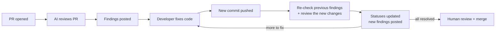

The system should eventually support:

- incremental PR reviews and previous-finding tracking
- multiple specialized reviewers with tool usage
- verification loops through critic and judge agents
- persistent PR memory and GitHub review threads
- human approval before merge (the bot never approves or merges)

## 2. Goals

**Primary goals**

1. Review PRs automatically, and again on every new commit.
2. Remember previous findings, and determine whether they were resolved.
3. Detect new problems and regressions introduced by later commits.
4. Use tools to verify findings instead of relying only on the LLM.
5. Reduce false positives and review spam.
6. Keep a clear audit trail of the agent's decisions.

**Learning goals.** The project demonstrates:

- agentic workflows and AI orchestration
- agent memory and structured agent state
- tool calling and MCP
- multi-agent systems and verification loops
- GitHub Actions and the Git/GitHub APIs

## 3. Implementation status

| Step | What | Status | Main code |
|---|---|---|---|
| 0 | Project setup (uv, pytest, entry point) | ✅ | `pyproject.toml`, `orchestrator/main.py` |
| 1 | GitHub Actions trigger | ✅ | `.github/workflows/pr-review.yml` (+ `pr-review-reusable.yml`) |
| 2 | GitHub client module | ✅ | `clients/github.py` |
| 3 | PR context builder | ✅ | `orchestrator/context_builder.py`, `models/pr_context.py` |
| 4 | First LLM review | ✅ | `agents/llm.py`, `agents/reviewer_agents/`, `models/finding.py`, `models/review.py` |
| 5 | Re-review on every commit | ✅ | verification only |
| 6 | Finding store (state in bot comments) | ✅ | `orchestrator/memory.py`, `models/review_state.py` |
| 7 | Wire memory into the review flow | ✅ | `orchestrator/main.py`, `orchestrator/memory.py`, `clients/github.py`; verified on a live PR on 2026-10-27 |
| 8 | Incremental diff | 📋 | `orchestrator/diff.py` |
| 9 | Finding re-check pass | 📋 | `orchestrator/recheck.py`, `prompts/recheck.md` |
| 9b | Inline review threads | 📋 | `clients/github.py`, posting path |
| 10 | LangGraph graph skeleton | 📋 | `graph/review_graph.py` |
| 11 | Tools layer | 📋 | `tools/` |
| 12 | Critic loop | 📋 | `prompts/critic.md` |
| 13 | Judge + confidence policy | 📋 | `prompts/judge.md` |
| 14 | Specialized reviewers | 📋 | `prompts/security-reviewer.md`, `prompts/testing-reviewer.md` |

**What the bot does today (Step 7).** On every `opened`, `synchronize` or `reopened` event, the bot:

1. Loads the state block from its newest valid comment, and shows the previous findings to a single **logic reviewer**.
2. Drops any finding that repeats an already-reported issue.
3. Files the genuinely new findings under stable IDs (`F001`, `F002`, …), each with a code snippet cut from the head file.
4. Posts one summary comment with "Previous findings" and "New findings" sections and the updated hidden state.
5. Skips the run (posting nothing) when the head commit was already reviewed.

Previous findings keep their stored status. Status changes (resolved, reopened) arrive with the Step 9 re-check.

---

# Part II: Architecture

## 4. Target architecture

This diagram shows the end state after Step 14. Dashed grey boxes do not exist yet.

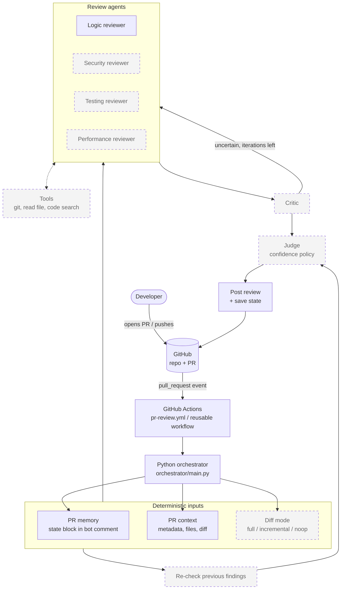

## 5. Current implementation architecture

This is the module view of the code as it stands at Step 7.

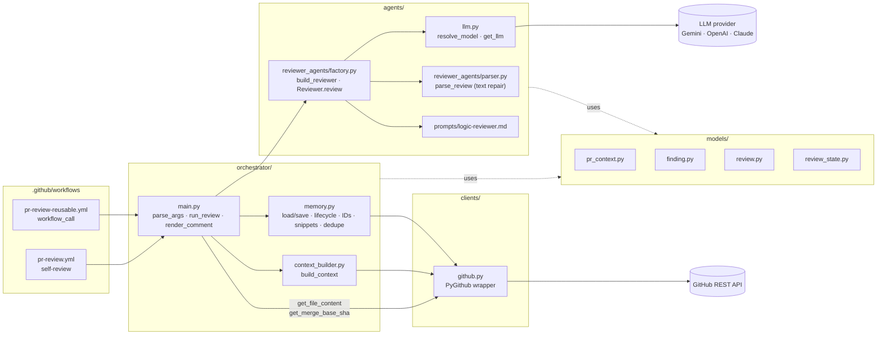

| Module | Responsibility |
|---|---|
| `orchestrator/main.py` | CLI entry (`--pr`, `--event`), token check, `run_review` pipeline, `render_comment`, and mapping fatal errors to exit code 1. `--pr 0` (manual dispatch) only smoke-tests the LLM. |
| `orchestrator/context_builder.py` | `build_context(pr)`: the only place that assembles GitHub data into a `PRContext`. |
| `orchestrator/memory.py` | State block render/parse, `load_memory` / `save_memory`, the lifecycle table (`ALLOWED_TRANSITIONS`, `transition`), `allocate_ids`, `cut_snippet`, `drop_duplicates`, `file_new_findings`. |
| `clients/github.py` | Every GitHub read/write: `verify_connection`, `get_pull_request`, `get_pr_files` (with blob `sha`), `get_pr_diff`, `get_file_content`, `get_merge_base_sha`, `get_existing_review_comments`, `post_review_comment`. `repo`/`client` are injectable so tests run offline. |
| `agents/llm.py` | `MODEL_PROVIDER` (`google` / `openai` / `claude`) plus the provider key and optional model override, passed to LangChain `init_chat_model`. |
| `agents/reviewer_agents/factory.py` | `build_reviewer(name)` loads `prompts/<name>.md` and binds it to the chat model. `Reviewer.review` renders the context, calls the LLM with structured output, falls back to text repair, and retries once. |
| `agents/reviewer_agents/parser.py` | Tolerant JSON extraction and repair into `ReviewResult` (code fences, prose around the JSON, a bare findings array). |
| `models/` | Pydantic contracts. See section 9. |

## 6. Layer responsibilities

| Layer | Responsibility | Today |
|---|---|---|
| GitHub | Source of truth for PRs, commits, files, comments, threads, CI status, **and the review state** (section 10) | ✅ |
| GitHub Actions | Detect PR events, provision the runner, start Python | ✅ |
| Python orchestrator | Deterministic pipeline: fetch data, call agents, apply memory rules, post | ✅ (linear `run_review`) |
| LangGraph | Explicit agent state, branches and loops | 📋 Step 10 |
| Agents | Specialized review reasoning | ✅ one logic reviewer · 📋 more |
| Tools | Read-only investigation of the repo on disk | 📋 Step 11 |
| Memory | Persist review state between runs | ✅ |
| LLM | Reasoning capability, behind one factory | ✅ |

### GitHub Actions starts the Python orchestrator

GitHub Actions handles the event and the execution environment. Python owns the agentic workflow. The YAML contains no review logic.

Workflow excerpt (`.github/workflows/pr-review.yml`, abridged):

```yaml
on:
  pull_request:
    types: [opened, synchronize, reopened]
  workflow_dispatch:            # manual test path → --pr 0

concurrency:                    # one run per PR; a newer push cancels the older run
  group: pr-review-${{ github.event.pull_request.number || github.ref }}
  cancel-in-progress: true

permissions:
  contents: read
  pull-requests: write

jobs:
  review:
    runs-on: ubuntu-latest
    env:
      GITHUB_TOKEN: ${{ secrets.GITHUB_TOKEN }}
      GITHUB_REPOSITORY: ${{ github.repository }}
      MODEL_PROVIDER: ${{ vars.MODEL_PROVIDER }}     # google | openai | claude
      GOOGLE_MODEL: ${{ vars.GOOGLE_MODEL }}         # optional overrides
      GOOGLE_API_KEY: ${{ secrets.GOOGLE_API_KEY }}  # + OPENAI_/ANTHROPIC_ keys
    steps:
      - uses: actions/checkout@v4
      - uses: astral-sh/setup-uv@v5
        with: { python-version: "3.12", enable-cache: true }
      - run: uv sync
      - run: |
          uv run python -m orchestrator.main \
            --pr "${{ github.event.pull_request.number || 0 }}" \
            --event "${{ github.event.action || 'push' }}"
```

Event semantics:

- `opened` starts the first review.
- `synchronize` runs when the PR branch receives a commit.
- `reopened` takes the same stateful path as `synchronize`: comments survive while a PR is closed, but the head may have moved.

### LLM layer

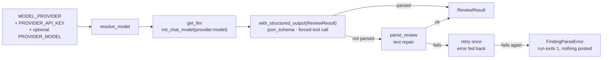

`resolve_model()` runs before any GitHub write, so a configuration error fails the run fast instead of halfway through. Provider defaults and the trade-offs between them live in [`llm-providers.md`](llm-providers.md).

## 7. Deployment & multi-repo

A workflow does not apply to other repositories by itself. There are three ways to run the reviewer across projects. The Python reviewer stays identical in all three; only the way events reach it changes.

| Approach | Where the workflow lives | Best for | Status |
|---|---|---|---|
| 1. Per-repository workflow | each project (copied YAML) | learning, a few repos | ✅ used for this repo's self-review |
| 2. Reusable workflow (`workflow_call`) | this repo; callers keep a thin wrapper | multiple projects | ✅ implemented |
| 3. GitHub App / webhook service | a central service | organization-wide, production | 📋 future |

### Option 2: reusable workflow (implemented)

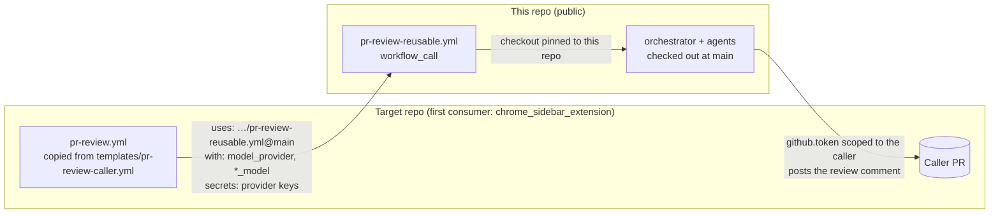

How a *called* workflow behaves:

- `github.token`, `github.repository` and `github.event` are **inherited from the caller**. The reviewer therefore posts on the caller's PRs, with the permissions the caller's job grants (`contents: read`, `pull-requests: write`).
- The checkout is **pinned to this repo**. The default checkout would fetch the caller's repo, which has no `orchestrator/`.
- LLM secrets are **explicitly forwarded** by the caller. `model_provider` and the model overrides arrive as `with:` inputs.
- The self-review workflow (`pr-review.yml`) stays separate on purpose. In a called workflow, `github.event.pull_request.*` belongs to the caller's PR, so one conditional file would resolve the wrong values.

Full guide: [`multi-repo-integration.md`](multi-repo-integration.md).

### Option 3: central GitHub App / webhook (future)

Repositories send PR events (repository, PR number, base/head SHA, event type) to one central Python + LangGraph service.

- **Pros:** no duplicated workflow logic; centralized memory and monitoring.
- **Cons:** more infrastructure; GitHub App authentication; a long-running worker.

The bot login would become `<app-slug>[bot]`, which is why `REVIEW_BOT_LOGIN` is configurable (section 10).

### Progression

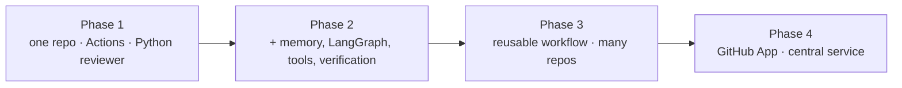

Phases 1 and 3 are in place. Phase 2 is in progress (memory done, LangGraph and tools planned).

## 8. Orchestrator data vs. agent tools

**PR data is fetched by the orchestrator, not by agents.** Before any agent runs, the pipeline calls the GitHub client and packs everything into a `PRContext`. Agents review what is already in front of them.

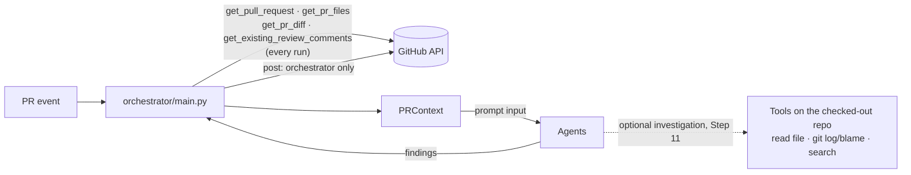

- PR metadata, changed files, the diff and previous findings arrive in the prompt. Agents never request them. Making an LLM decide to fetch data that every run needs would only burn tokens and risk the step being skipped.
- **Posting is orchestrator-only.** It happens after the decision about what gets reported. If agents posted directly, one hallucination would mean public spam on the PR.
- The `repo` / `client` parameters on `clients/github.py` exist so **tests** can mock GitHub. They are not an agent interface.
- **Agent tools are for optional investigation** that the PR data cannot cover, for example: "the diff calls `parse_config()`; read it to check whether it can return None." They run against the repo on disk: fast, free and outside API rate limits.

| Who | Fetches | When |
|---|---|---|
| Orchestrator | PR metadata, files, diff, prior comments, head file contents, merge-base | Always, before and after the review |
| Agents | Repo files, git history, code search | Only when they choose to investigate (Step 11) |

The orchestrator decides:

- what was reviewed before and what changed
- which previous findings to re-check
- which agents run
- what is saved
- what is posted

It does not make the code-review judgments itself.

---

# Part III: Data & memory

## 9. Data model

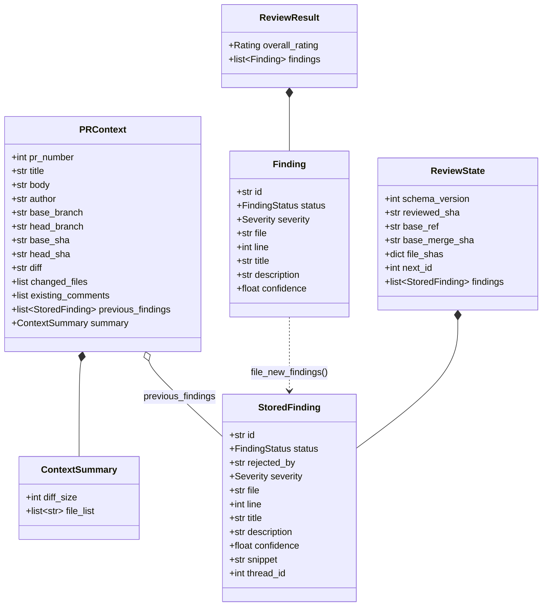

There are two kinds of finding on purpose:

| | `Finding` (`models/finding.py`) | `StoredFinding` (`models/review_state.py`) |
|---|---|---|
| Written by | the reviewer LLM (structured output) | the orchestrator only |
| `id` | the LLM's own `F001…` numbering, thrown away | stable ID from `next_id`, never reused |
| `status` | always `new` | never `new`; lifecycle in section 11 |
| Extra fields | none | `rejected_by`, `snippet` (cut from the head file), `thread_id` (Step 9b) |
| Limits | none | `line ≥ 1`, `description ≤ 300` chars, `extra="forbid"` |

Other enums and constants:

- `Severity`: `low | medium | high | critical`. This is how bad the issue would be if real, and it is independent of `confidence`.
- `Rating`: `approve | comment | request_changes`. These mirror GitHub review states. If a model returns a bare findings array, `derived_rating` computes the rating from the severities.
- `ReviewState()` with no arguments is the **empty state**: no previous review, so the run does a full review and IDs start at `F001`.

`ReviewState` validation enforces two invariants: IDs are unique, and `next_id` is greater than every stored ID.

## 10. Memory: state embedded in bot comments

### What memory means here

The LLM does not remember a PR. The system stores structured state and gives the relevant part back to the agent on the next run. Memory answers these questions:

- Which commit was last reviewed, and against which base?
- Which findings exist, what is each one's status, and who rejected it?
- What code did each finding point at (the snippet, used for re-checks)?
- Which GitHub thread belongs to each finding (Step 9b)?

### Where it lives (decided 2026-10-25)

Every Actions run starts on a fresh runner, so the state rides inside each bot comment as a hidden HTML comment. It is invisible on the rendered page and returned verbatim by the API.

```markdown
🤖 AI Review

## Review Findings
...human-readable findings...

<!-- ai-review-state:v1 {"schema_version":1,"reviewed_sha":"abc789…","base_ref":"main",
 "base_merge_sha":"9f1e2d…","file_shas":{"src/JobService.java":"1a2b…"},"next_id":4,
 "findings":[{"id":"F001","status":"open","rejected_by":null,"severity":"medium",
   "file":"src/JobService.java","line":82,"title":"Page number is not validated",
   "description":"…","confidence":0.92,"snippet":"int offset = page * size;","thread_id":null}]} -->
```

### Load

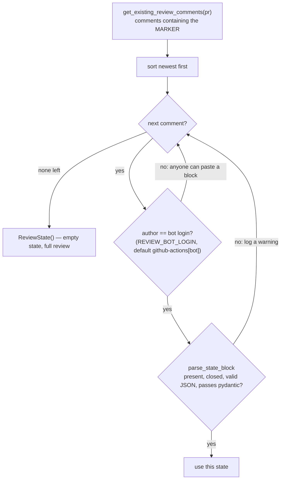

- **Fallbacks.** A corrupt newest block falls back to an older valid one, so IDs do not restart at `F001`. When nothing is usable, the run gets the empty state.
- **Trust.** The parsed state came from an editable comment, so it stays untrusted. When previous findings are shown to the LLM, each is collapsed to one line and labelled as data, not instructions (section 25).

### Save

`save_memory(pr, body, state)` renders the block and appends it to the review body, then posts it with `post_review_comment`. **Posting is saving.** There is no separate write, so:

- the stored state can never disagree with what the developer saw;
- a failed post saves nothing, and the next run starts from the old SHAs;
- the newest valid comment holds the current state, and older comments are free history.

### Encoding and size

- **Escaping.** After JSON serialisation, `<` and `>` are written as `<` / `>`. This is still valid JSON for the same text, and it means a snippet containing `-->` cannot close the HTML comment early.
- **Size cap.** Comment bodies max out at 65,536 chars, and the block is capped at `MAX_STATE_BLOCK_CHARS = 20_000`. When it is too large, the oldest `closed`/`rejected` findings are dropped first, and `next_id` is kept so dropped IDs are never reused. If it still does not fit, the run raises `StateTooLargeError` and posts nothing. Open findings are never dropped, because losing one would re-report it under a new ID.
- **Visibility.** The block is readable in the raw comment source, including findings that will later be "recorded in memory only" (section 23).

### Rejected alternatives

| Option | Problem |
|---|---|
| Local `memory/pr-N.json` | Every Actions run starts on a fresh runner, so the file is gone next run |
| Commit to the repo / an orphan branch | Needs `contents: write` on callers' repos; push conflicts |
| `actions/cache` | Evicted after 7 days unused, 10 GB/repo cap, scoped to `refs/pull/N/merge` |
| Actions artifacts | 90-day default retention; must look up the previous run's artifact |

`load_memory` / `save_memory` are the only interface. A future database (PostgreSQL tables for PR, Finding and Review, for cross-PR metrics and reviewer accuracy) can replace the storage without touching callers.

## 11. Finding lifecycle & regressions

The allowed moves are enforced by `ALLOWED_TRANSITIONS` in `orchestrator/memory.py`. Any other move raises `IllegalTransitionError`, and so does a move to the same status. A "still open" re-check verdict means *no transition*.

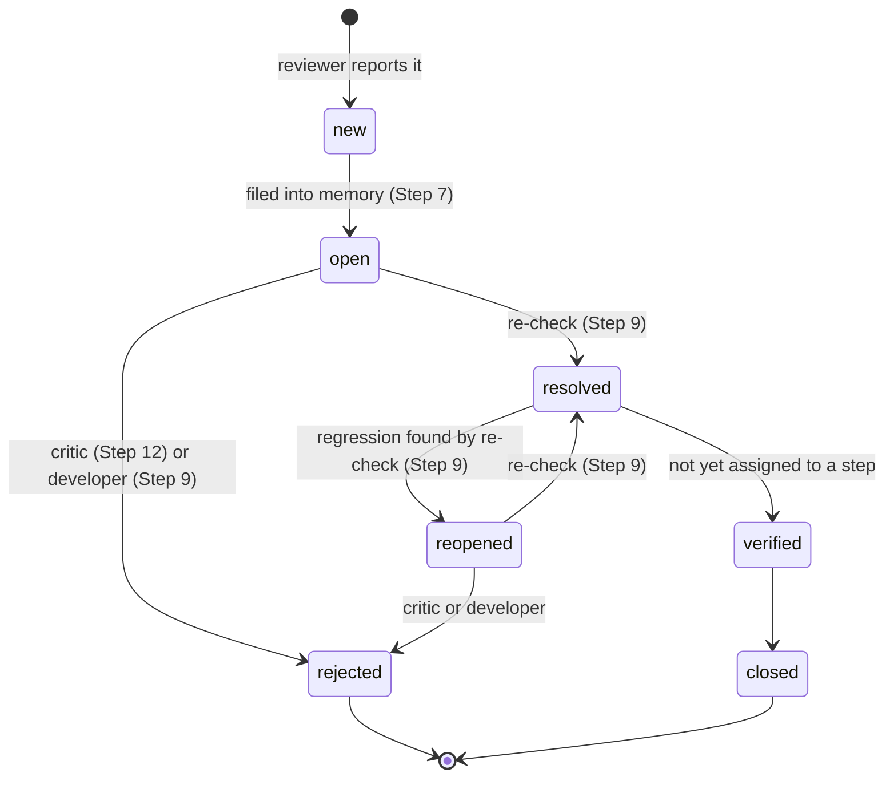

- `new` is transient. It is never stored, and validation rejects it.
- `rejected` carries `rejected_by: critic | developer`. It is set exactly when the status is `rejected`, so the audit trail says who dismissed the finding.
- `rejected` and `closed` are terminal. Only closed and rejected findings may be trimmed from an oversized block.
- **`KNOWN_ISSUE_STATUSES` = {open, reopened, resolved, rejected}** are the findings that count as *already reported*. The reviewer is shown them and told not to repeat them, dedupe drops repeats of them, and the comment lists them. `verified` and `closed` are excluded: their fix was confirmed, so if the issue comes back it is a new finding.

### Regressions

```text
Commit 1   F001 → open
Commit 2   F001 → resolved      (fix detected by re-check)
Commit 3   F001 → reopened      (problem reintroduced)
```

Re-checking **resolved** findings whose file changed is what makes this possible. It is one of the main reasons the system has persistent memory.

## 12. Finding identity, snippets & dedupe

**IDs.** `allocate_ids(state, n)` hands out `F{next_id:03d}…` and advances `next_id`. Past 999, the ID grows a digit (`F1000`). The counter only grows, so an ID is never reused, not even after its finding was trimmed.

**Snippets.** `cut_snippet(file_text, line, context=3)` returns lines `line ± 3` of the **head file**, fetched with `get_file_content(path, ref=head_sha)` once per file that has findings.

- The window is clamped at both ends of the file.
- A line past EOF gives `""`.
- CRLF is normalised to LF.
- The LLM is never trusted to quote code, because it paraphrases and re-indents.
- An empty snippet is logged as a warning, since Step 9 cannot re-check that finding properly.

**Filing.** `file_new_findings` coerces untrusted LLM fields instead of failing the whole review:

- a line below 1 is stored as 1;
- a description over 300 chars is cut and ends with `…` (the visible comment still shows it in full);
- a missing file text gives an empty snippet.

**Dedupe** (`drop_duplicates`, before any ID is allocated). A reviewer finding is a duplicate of an earlier one when both are **in the same file** and either:

- (a) the normalised titles are equal (lowercase, punctuation stripped, whitespace collapsed), or
- (b) the lines are within **±3** (`DUPLICATE_LINE_WINDOW`) **and** the titles are similar, with a `difflib.SequenceMatcher` ratio of at least **0.6** (`DUPLICATE_TITLE_SIMILARITY`).

"Earlier" means a stored finding in a `KNOWN_ISSUE_STATUSES` status, *or* a finding kept earlier in the same batch, since the reviewer sometimes reports one issue twice.

Two things are deliberately *not* used:

- **Snippets.** They are cut around whatever line the LLM names, so a 2-line drift would break an exact match.
- **Line proximity alone.** Two different bugs on adjacent lines must both be kept. Hiding a real finding is worse than showing a duplicate.

Known gap: a heavy rewording at a moved line still gets through. The 0.6 threshold is a starting guess to tune against real output, and Step 14's merge revisits dedupe.

---

# Part IV: Review flows

## 13. Current review flow (Step 7)

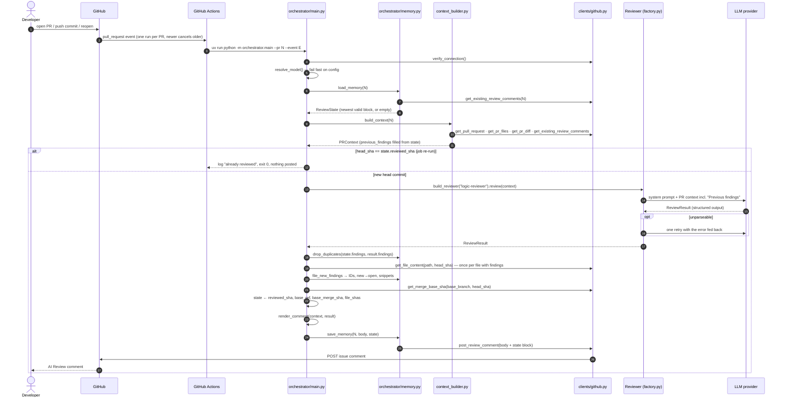

**Step-by-step trace**

1. **Trigger.** A `pull_request` event (`opened` / `synchronize` / `reopened`) starts the workflow. The `concurrency` group cancels an in-flight run for the same PR.
2. **Boot.** Checkout, `setup-uv` (Python 3.12), `uv sync`, then `python -m orchestrator.main`. `--pr 0` (manual dispatch) only verifies the token and pings the LLM.
3. **Fail-fast checks.** `verify_connection()` checks the token, and `resolve_model()` checks the LLM config. Both run before any write.
4. **Memory.** `load_memory` returns the newest valid state (section 10). `build_context` fetches PR data, and `run_review` sets `previous_findings` on the context from that state.
5. **Same-SHA skip.** If the head was already reviewed, log it and exit 0 without posting.
6. **Review.** One LLM call with structured output (section 6). Previous findings in `KNOWN_ISSUE_STATUSES` are listed one per line with the instruction not to re-report them.
7. **Dedupe and filing.** Duplicates are dropped (section 12). New findings get stable IDs, `new → open`, and snippets from the head file. The visible comment uses the stored IDs, so it matches the state block.
8. **Record coverage.** `reviewed_sha`, `base_ref`, `base_merge_sha` and `file_shas` are updated. Step 8 diffs from this point, and Step 9 skips files whose blob is unchanged.
9. **Post = save.** The comment and state block are posted in one API call.

**Failure handling.** Every fatal error exits 1 with nothing posted. An empty or missing comment must never look like a clean review.

| Exception | Cause |
|---|---|
| `RuntimeError` | Missing token / repo / provider / API key |
| `GithubException` | GitHub API failure (forbidden, PR or repo missing) |
| `FindingParseError` | Reviewer output unparseable twice |
| `StateTooLargeError` | Too many open findings to fit the state block |

## 14. Comment format

### Today (Step 7)

`render_comment` takes metadata from `PRContext`, never from the model. The model only supplies the rating and the findings. `post_review_comment` prepends the `🤖 AI Review` marker.

```markdown
🤖 AI Review

## Review Findings

**Overall: comment** · branch `feat/pagination` @ `abc7890123` · 2 file(s) checked

Files checked: src/JobService.java, src/JobServiceTest.java

**Previous findings (2):**

- **F001** — Page number is not validated · `src/JobService.java:82` · open
- **F002** — Missing empty-result test · `src/JobServiceTest.java:41` · open

**New findings (1):**

### F003 — Page size is not capped
`src/JobService.java:90` · severity: **medium** · confidence: 0.88

The API accepts an arbitrarily large page size. Clamp it before querying.

<!-- ai-review-state:v1 {…} -->
```

- **Previous findings** are one line each: ID, title, location, status, plus `(critic|developer)` for rejected findings. Lists over 10 items, and file lists over 10 items, collapse into `<details>`.
- With previous findings and nothing new, the comment says "No new issues found." With no history and nothing found, it says "No issues found. 🎉" Neither message is shown while a known issue is listed.

### Target (Step 9 onward)

Previous findings carry their re-check outcome, for example ✅ resolved, 🟡 still open, 🔁 reopened, or "rejected (developer)" with an acknowledgement. New findings follow in full. The exact markers are settled in Step 9. From Step 9b, the same content is split between a review summary and inline threads (section 17). From Step 13, findings scoring 0.75–0.89 carry a "suggestion / needs verification" label (section 23).

## 15. Incremental diff (Step 8, planned)

On `synchronize`, the reviewer should look at `reviewed_sha → head` instead of the whole PR, but only when that range is pure PR work. **Never use `pr.base.sha`.** It is a snapshot taken when the PR was opened or retargeted, and it does not move with the base branch.

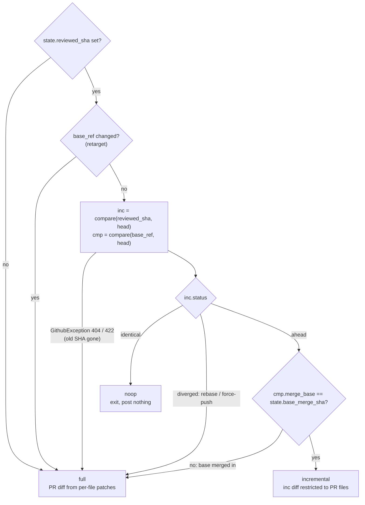

PyGithub's `compare()` is lazy. The exception surfaces on first attribute access (for example `.status`), not on the call itself. The chosen mode is recorded as `PRContext.diff_mode` so later agents know what they are looking at.

| Scenario | Diff mode |
|---|---|
| New commits pushed (one or many at once) | incremental |
| Base branch moves ahead (not merged in) | incremental |
| Base branch merged into the PR branch / "Update branch" (merge) | full |
| Rebase / force-push / "Update branch" (rebase) | full |
| Child PR (B → A) merged into this PR's branch | incremental (= B's changes) |
| Base retargeted (stacked PR after its parent merged) | full |
| Job re-run at the same SHA | noop (Step 7 already skips this case) |
| Push while the PR has merge conflicts | no run (GitHub skips it); the next run picks it up |

## 16. Re-check pass & developer explanations (Step 9, planned)

This step is the core differentiator. Previous findings are explicitly re-checked and their statuses updated.

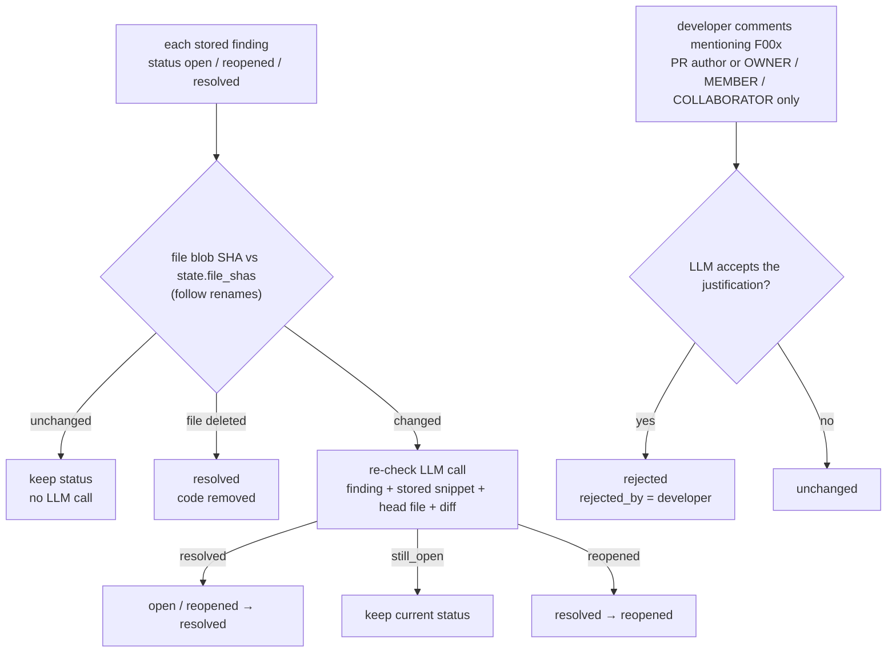

- The blob-SHA skip works in every diff mode, so most findings cost nothing.
- The re-check locates the stored snippet *near* the old line, because lines above it may have been added or removed.
- `still_open` is a verdict, not a status. The re-check never outputs a dismissal; dismissal belongs to the developer path or the critic.
- Every move goes through the lifecycle table (section 11).
- **Developer explanations.** Issue comments created after the last state comment that mention a finding ID are passed to the LLM as untrusted data, from trusted authors only. On a public repo, anyone can comment. Explanations are read on the next run; replying alone does not trigger one (section 29).
- **Posting rule moves here.** Skip posting when no status changed and there are no new findings (section 19).

## 17. Inline review threads (Step 9b, planned)

This is the earliest point where inline comments do not create noise. Before Step 9 the bot cannot tell resolved from still-open findings, so every push would re-post N inline comments. It comes before the Step 10 graph refactor so that posting is not restructured twice.

- **One review per run** via `pr.create_review(commit, body, event="COMMENT", comments=[…])`. The review body holds the summary and the state block. Each reportable finding becomes an inline comment, and its id is stored as `thread_id`.
- **`event="COMMENT"` only.** `APPROVE` / `REQUEST_CHANGES` from `github-actions[bot]` is gated by a repo setting that is off by default, and humans approve (section 25).

| Re-check outcome | Thread action |
|---|---|
| resolved | reply "✅ Resolved in `<sha>`", then resolve the thread via GraphQL `resolveReviewThread` (PyGithub has no wrapper) |
| still open | nothing (no new comment) |
| reopened | reply in the same thread |
| developer reply in the thread | linked via `in_reply_to_id`; replaces the `F00x:` convention, with the same author filter |

Constraints:

- GitHub rejects inline comments on lines outside the diff with a 422 error, and one bad comment fails the whole review. Lines are therefore checked against the patch hunks first, and findings that cannot be placed go in the summary only.
- A thread goes outdated when its line moves. An open finding is then re-posted at its new line, located by the stored snippet.
- State is loaded from review bodies *and* issue comments, so PRs reviewed before 9b keep their state.
- Unverified until tried on a real PR: that `resolveReviewThread` works with the workflow's `GITHUB_TOKEN`, and the exact 422 behaviour.

## 18. Worked example

This is the target end-to-end experience after Step 14, for PR 123 "Add pagination to job search API":

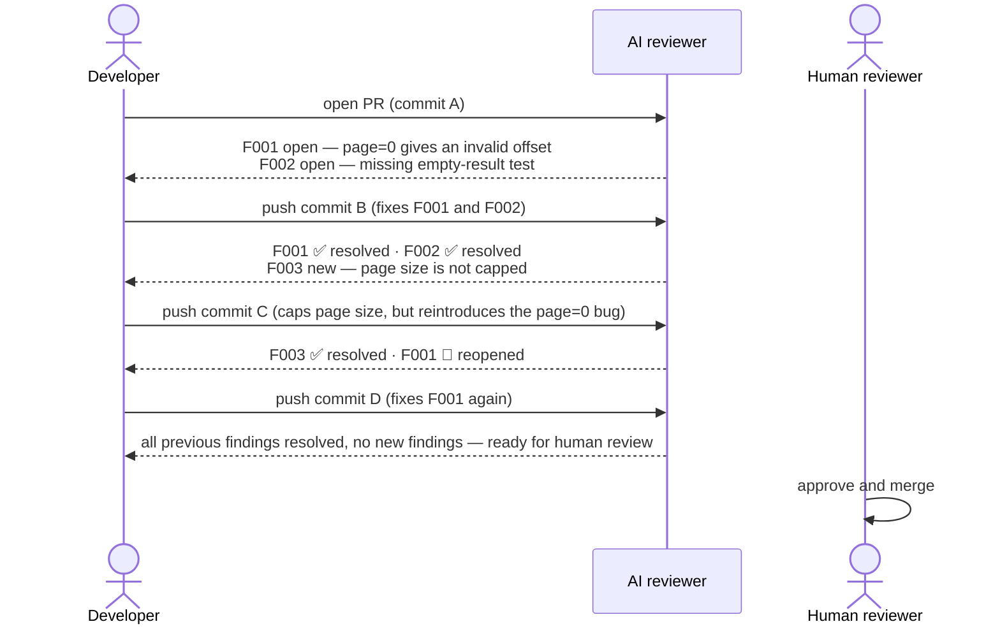

The fix in commit B, for example:

```java
// before
int offset = page * size;
// after
int safePage = Math.max(page, 1);
int offset = (safePage - 1) * size;
```

**What happens today (Step 7).**

- Commit A posts F001 and F002.
- Commit B's comment lists F001 and F002 under "Previous findings" with their stored status `open`, because status updates need Step 9. It does not re-file them under new IDs, and it files F003 if the reviewer reports it.
- The hidden block in each comment matches its visible content, with `reviewed_sha` set to that commit.

This behaviour was verified on the Step 7 PR on 2026-10-27; the roadmap's Step 7 entry has the details.

## 19. Avoiding review spam

The bot should not post the same comment every time.

```text
Bad:     Commit 1 "Missing validation."   Commit 2 "Missing validation."   Commit 3 "Missing validation."
Better:  Commit 1 "Missing validation."   Commit 2 "F001 still open."      Commit 3 "F001 resolved."
```

| Rule | Step | Status |
|---|---|---|
| Show previous findings to the reviewer with "do not re-report" | 7 | ✅ |
| Drop duplicates against memory and within the batch before allocating IDs (section 12) | 7 | ✅ |
| Skip when `head_sha == reviewed_sha` (job re-run) | 7 | ✅ |
| `noop` diff mode → exit without posting | 8 | 📋 |
| Post only on change: skip when no status changed and there are no new findings. `reviewed_sha` then stays put, and the next run's range covers the skipped commits | 9 | 📋 |
| Finding ID ↔ inline thread; "still open" stays silent in the thread | 9b | 📋 |

The "post only on change" rule cannot apply in Step 7. Without a re-check no status can change, so it would suppress every follow-up comment that has no new findings.

---

# Part V: Agentic layer (planned)

## 20. Target LangGraph graph

Framework: LangGraph 1.x, a hand-built `StateGraph` with Pydantic state. See [`framework-decision.md`](framework-decision.md).

**Step 10** is a pure refactor. The linear `run_review` becomes the nodes `load_memory → build_diff → review → recheck → judge_placeholder → update_memory → post_review`. It is verified by equivalence: the Step 9 and 9b scenarios must produce identical state, content and thread actions. Steps 11–14 then grow the graph into:

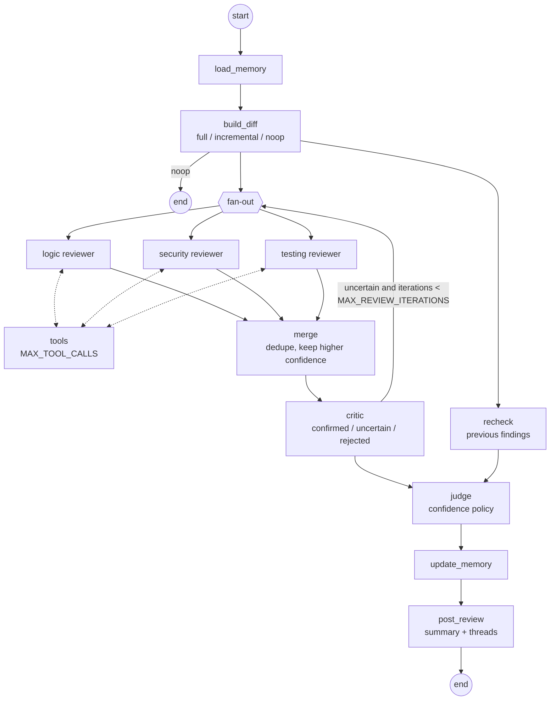

Graph state is a typed object wrapping `PRContext` and the intermediate results. Findings carry a `source_reviewer` tag, and the re-check routes each previous finding back to its original reviewer.

## 21. Agent roles

A single agent may miss a problem, over-report one, anchor on its first conclusion, or misread code. Specialized reviewers give independent perspectives. More agents do not guarantee correctness, though, which is why the critic and judge stages exist. The critic asks: *is there enough evidence that this finding is real?* The judge asks: *should this finding actually be reported?*

| Reviewer | Checks | Status |
|---|---|---|
| **Logic** (`prompts/logic-reviewer.md`) | wrong conditions, off-by-one, copy-paste mistakes; edge cases (empty, zero, max, unicode); None/missing error handling at trust boundaries; races and ordering; regression risk; wrong assumptions (types, units, encodings, time zones); resource lifecycle | ✅ |
| **Security** | authentication, authorization, injection, XSS, secrets, unsafe input, dependencies, sensitive data exposure | 📋 Step 14 |
| **Testing** | missing or weak tests, incorrect mocks, untested edge cases, regression coverage | 📋 Step 14 |
| **Performance** | expensive queries, unnecessary API calls, N+1, large loops, memory use, caching | 📋 after the prototype |

## 22. Tools & MCP

The tools are read-only plain functions in `tools/` (Step 11), bound to reviewers through the agent factory. They can be exposed over MCP later.

| Group | Examples | Status |
|---|---|---|
| Git | `git diff`, `log`, `show`, `blame` (subprocess wrappers) | 📋 Step 11 |
| Repository | `read_file(path, ref)`, `search_code(query)`; later find symbol / references | 📋 Step 11 |
| Tests | `npm test`, `mvn verify`, lint/build | 📋 after the prototype; executing repo code needs a security review first |
| Security | dependency audit, secret scanner, SAST | 📋 future |
| GitHub | none for the prototype; everything is already in `PRContext` | by design |

**GitHub writes are orchestrator-only, permanently.** If an agent ever needs GitHub data mid-review, it gets a thin read-only adapter.

```text
read-only (adapter candidates):        orchestrator-only (never tools):
  get commits                            create review / comment
  get review comments / threads          reply to comment
  get CI status                          resolve thread
```

**MCP** is the tool *interface* through which agents reach Git, the repo, tests and scanners. It is not the memory and not the model, and it stays out of scope until plain-function tools prove the need.

## 23. Verification, confidence & loop limits

### Verification loop (critic, Step 12)

The agent should not post every suspected problem immediately.

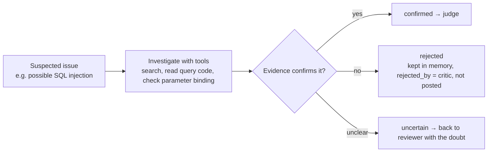

### Confidence policy (judge, Step 13)

| Confidence | Action | Inline thread (from 9b) |
|---|---|---|
| ≥ 0.90 (`REPORT_THRESHOLD`) | report normally | normal thread |
| 0.75–0.89 (`SUGGESTION_THRESHOLD`) | report as "suggestion / needs verification" | labelled thread |
| < 0.75 | record in memory only | none |

Confidence is already stored on every `StoredFinding`, so a suggestion keeps its label when it is listed again. The thresholds should be tuned against real output, not treated as permanent rules.

### Loop limits

```text
MAX_REVIEW_ITERATIONS = 3      critic → reviewer round trips
MAX_TOOL_CALLS        = 20     per reviewer, enforced in the tool-binding loop
MAX_REVIEW_TIME       = 10 min
```

These limits prevent infinite agent loops and uncontrolled cost.

## 24. Agent rules

1. Do not report an issue without evidence.
2. Prefer repository evidence over assumptions.
3. Check existing code before claiming something is missing.
4. Do not report style preferences as bugs.
5. Do not duplicate existing findings.
6. Re-check previous findings after every new commit.
7. Distinguish confirmed problems from uncertain concerns.
8. Use tools when they can verify a claim.
9. Keep comments concise and actionable.
10. Never modify the developer's code unless the workflow explicitly allows it.

Rules 1, 4, 5, 7 and 9 are in `logic-reviewer.md` today. Rule 8 ("use tools to verify before reporting") arrives with Step 11.

---

# Part VI: Operations & reference

## 25. Security considerations

The bot reads source code and, later, will run tools. The baseline is:

```text
Agent can READ        Agent can COMMENT
Agent cannot MERGE    Agent cannot APPROVE    Agent cannot modify code or production
```

**Already in place**

- **Token scope.** `contents: read` + `pull-requests: write` only. In the reusable workflow the token is scoped to the caller, and a called workflow cannot elevate beyond the caller's grant.
- **Least-privilege secrets.** Callers forward only the provider keys, not `secrets: inherit`. Optional `if:` gates in the caller template can block fork PRs, filter by author association, or limit runs to protected base branches.
- **Untrusted state.** Only comments authored by the bot login are used. Every block is schema-validated with `extra="forbid"`, an invalid block falls back to an older one, and `<`/`>` are escaped so the block cannot break out of its HTML comment.
- **Prompt injection.** Previous findings are rendered one line each with whitespace collapsed, so a newline cannot forge a prompt section. The prompt states the section is data, not instructions. Developer explanations (Step 9) are passed as untrusted data and only from trusted author associations.
- **No agent writes.** Posting is orchestrator-only (section 8).
- **Honest failure.** Every fatal error exits 1 with nothing posted.

**Still to do**

- Run tools in an isolated environment, limit shell commands and network access, and log agent tool calls.
- Security-review any tool that executes repo code before adding it.
- Keep a human approval step before merge.

## 26. Technology stack

| Component | Technology | Status |
|---|---|---|
| Language / runtime | Python 3.12, managed with **uv** (`pyproject.toml`, `uv.lock`) | ✅ |
| Event trigger / runner | GitHub Actions (self-review + reusable `workflow_call`) | ✅ |
| GitHub integration | **PyGithub** (REST); GraphQL for `resolveReviewThread` (Step 9b) | ✅ / 📋 |
| LLM access | LangChain `init_chat_model` + `with_structured_output` | ✅ |
| Models | Gemini (`langchain-google-genai`), OpenAI (`langchain-openai`), Claude (`langchain-anthropic`), selected by `MODEL_PROVIDER`; see [`llm-providers.md`](llm-providers.md) | ✅ |
| Data contracts | Pydantic v2 | ✅ |
| Memory | JSON state block in bot PR comments (section 10) | ✅ |
| Tests | pytest; tests mirror the source tree, run fully offline with a mocked GitHub | ✅ |
| Agent workflow | LangGraph 1.x ([decided](framework-decision.md)) | 📋 Step 10 |
| Tool protocol | plain functions → MCP later | 📋 |
| Agent runtime / harness | OpenCode (optional later experiment) | 📋 |
| Long-term memory | PostgreSQL / SQLite (only if cross-PR metrics are needed) | 📋 |

## 27. Repository structure

```text
github_agentic_pr_reviewer/
├── .github/
│   ├── workflows/
│   │   ├── pr-review.yml              # self-review of this repo's PRs
│   │   └── pr-review-reusable.yml     # workflow_call for other repos
│   └── rulesets/                      # main-branch protection ruleset
├── agents/
│   ├── llm.py                         # MODEL_PROVIDER → chat model
│   └── reviewer_agents/
│       ├── factory.py                 # build_reviewer, Reviewer.review, render_pr_context
│       ├── parser.py                  # JSON repair → ReviewResult
│       └── prompts/
│           ├── logic-reviewer.md
│           ├── recheck.md             # 📋 Step 9
│           ├── critic.md              # 📋 Step 12
│           ├── judge.md               # 📋 Step 13
│           ├── security-reviewer.md   # 📋 Step 14
│           └── testing-reviewer.md    # 📋 Step 14
├── clients/
│   └── github.py                      # all GitHub reads/writes
├── models/
│   ├── finding.py                     # Finding, FindingStatus, Severity
│   ├── pr_context.py                  # PRContext, ContextSummary
│   ├── review.py                      # ReviewResult, Rating, derived_rating
│   └── review_state.py                # ReviewState, StoredFinding, KNOWN_ISSUE_STATUSES
├── orchestrator/
│   ├── main.py                        # entry point, run_review, render_comment
│   ├── context_builder.py             # build_context
│   ├── memory.py                      # state block, lifecycle, IDs, snippets, dedupe
│   ├── diff.py                        # 📋 Step 8
│   └── recheck.py                     # 📋 Step 9
├── graph/review_graph.py              # 📋 Step 10
├── tools/                             # 📋 Step 11 (git_tools.py, repo_tools.py)
├── templates/pr-review-caller.yml     # copy into a target repo
├── tests/                             # mirrors the source tree; fixtures/ + helpers.py
├── docs/
├── .env.example
├── pyproject.toml
└── uv.lock
```

There are no `__init__.py` files. The packages are PEP 420 namespace packages, and pytest runs with `pythonpath = ["."]` and `--import-mode=importlib`.

## 28. Roadmap mapping

The build order is deliberately incremental: make the end-to-end Python loop work first, then add one layer at a time. LangGraph is **not** used for the first implementation. Step 10 introduces it only once the behaviour is complete, as a refactor verified by equivalence, so it is always clear which component is responsible for what.

| Phase | Theme | Roadmap steps | Status |
|---|---|---|---|
| A | Setup | 0–1 | ✅ |
| B | Minimal end-to-end review (stateless): PR → LLM → comment | 2–5 | ✅ |
| C | Memory | 6–7 | ✅ |
| D | Incremental review, finding re-check, inline threads | 8, 9, 9b | 📋 |
| E | Agentic structure: graph, tools, critic, judge, specialized reviewers | 10–14 | 📋 |

Details, task lists and "done when" checks: [`implementation-roadmap.md`](implementation-roadmap.md).

**After the prototype** (out of scope until Step 14 is green):

- Performance reviewer.
- MCP tool interface.
- Test-executing tools.
- GitHub App / central service.
- SQLite/PostgreSQL memory.
- Automation features: `/ai-review` commands, opt-in `/ai-fix`, auto-suggested tests, PR metrics (false-positive rate, reviewer accuracy), review-history summaries.

## 29. Open questions & known limitations

### Models
- One model for everything, or a different model per reviewer?
- A cheap model for the initial review and a stronger one for the judge? See [`llm-providers.md`](llm-providers.md).

### Triggers
- Add `pull_request: edited`, filtered on `github.event.changes.base`, so a retarget re-reviews immediately? This needs job-level `concurrency` (with `github.workflow` in the group name) so title/body edits don't cancel an in-progress review.
- Add `issue_comment: created` (with `if: github.event.issue.pull_request`) so a developer explanation is processed without a new push? Note that this event always runs the workflow from the default branch.

### Multi-agent strategy
- Parallel or sequential reviewers? Sequential is acceptable for the prototype; Step 14 should note the choice.

### Review behaviour
- GitHub suggestion blocks (` ```suggestion `)? This pairs with automation level 3.
- Which step drives `resolved → verified → closed`? No step owns it yet.

### Automation level

| Level | Scope |
|---|---|
| 1 | review only |
| 2 | review + verification |
| 3 | review + suggested fixes |
| 4 | review + automatic fixes |
| 5 | review + fix + test + update PR |

The starting point is level 1 → 2, then autonomy increases gradually.

### Known limitations (accepted for now)
- **Fork PRs.** No secrets and a read-only token, so no review is posted and no state is saved.
- **Bot pushes.** Pushes and merges made with `GITHUB_TOKEN` do not start workflow runs, so there is no review until the next human push.
- **Per-PR findings.** A dismissal on PR B is not carried to PR A when B merges into A's branch.
- **API caps.** Compare returns at most 300 files, and the PR files API at most 3,000. `patch` may be missing for large or binary files, and `get_file_content` returns None for files over 1 MB.
- **State block size** (section 10): too many open findings → `StateTooLargeError`.
- **Dedupe misses heavy rewordings** at a moved line (section 12).
- **Static statuses until Step 9.** Previous findings keep their status, so "Previous findings" can list a fixed issue as `open`. This was seen on the Step 7 PR: F001–F003 were fixed by Step 7 itself but are still listed as open.
- **"Overall" rates only new findings.** A comment can say `approve` while listing open findings. Fixed in Step 9.
- **Deleted files in `file_shas`.** The PR files API reports a removed file with its old blob SHA, and `run_review` stores it. This is harmless until the Step 9 re-check relies on `file_shas`, and is fixed in Step 9 task 1.
- **Unpinned reviewer version.** The reusable workflow runs the reviewer from `main`. Pinning means changing both `@main` in the caller and the checkout `ref`.

## 30. Decision log

| When | Decision | Where |
|---|---|---|
| 2026-10-22 | Agent framework: **LangGraph 1.x**, hand-built `StateGraph`, over CrewAI / plain LangChain | [`framework-decision.md`](framework-decision.md), section 20 |
| Step 2 | GitHub client is orchestrator plumbing; agents never call the GitHub API, and writes are orchestrator-only | section 8, section 22 |
| Step 4 | Provider-agnostic LLM factory (`MODEL_PROVIDER`), `with_structured_output` + text-repair fallback + one retry; an unparseable review fails the run | section 6, [`llm-providers.md`](llm-providers.md) |
| Oct 2026 | Multi-repo via a **reusable workflow** with explicit secret forwarding (not `secrets: inherit`) | section 7, [`multi-repo-integration.md`](multi-repo-integration.md) |
| 2026-10-25 | Memory: **state embedded in bot PR comments**; posting = saving | section 10 |
| 2026-10-25 | Incremental-diff rule based on merge-base and compare status; never `pr.base.sha` | section 15 |
| 2026-10-25 | Summary comment through Step 9, **inline review threads from Step 9b** (before the graph refactor); `event="COMMENT"` only | section 17 |
| Step 7 | Dedupe by same file + (equal title, or ±3 lines and similarity ≥ 0.6); snippets not compared | section 12 |
| Step 7 | Only the same-SHA skip ships in Step 7; "post only on change" moves to Step 9 | section 19 |
| Step 7 | Snippets are cut by the orchestrator from the head file, never copied by the LLM | section 12 |

## 31. Target end state & core principle

The eventual system behaves like a small engineering team that keeps reviewing the PR as it evolves. The developer remains the final decision maker. The agent's job is to **inspect, remember, verify and report**.

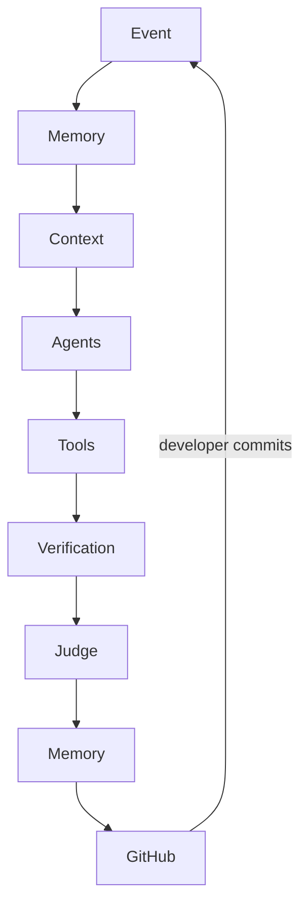

The core loop, and the main learning objective of the project:

> **Observe → Remember → Investigate → Reason → Verify → Act → Remember**
