# Agentic PR Review System — Architecture

> **Status:** Living document. Describes the code through roadmap Step 9b.
> **Last updated:** 2026-11-12
> **Related:** [`implementation-roadmap.md`](implementation-roadmap.md) (build steps, task lists, verification records) · [`framework-decision.md`](framework-decision.md) · [`llm-providers.md`](llm-providers.md) · [`multi-repo-integration.md`](multi-repo-integration.md)
> **Legend:** ✅ built · 🚧 built, live verification pending · 📋 planned.
>
> **Diagram conventions** (all diagrams use the same visual language):
>
> | Element | Meaning |
> |---|---|
> | Amber box | An LLM call: costs money, answers can vary |
> | Blue cylinder | External system (GitHub, LLM provider) |
> | Green box | A resulting status or outcome |
> | Dashed grey box | Planned, not built |
> | Diamond | A decision |
> | `file · function` in a box | Where that box lives in the code |
> | Step ID (`1`–`8`, `3b`, `4a`, `4b`) | The step in the review-flow table (section 7), which also gives its log tag |

## Contents

1. [Summary](#1-summary)
2. [Goals and non-goals](#2-goals-and-non-goals)
3. [Status](#3-status)
4. [System context](#4-system-context)
5. [Components](#5-components)
6. [Data and state](#6-data-and-state)
7. [Review flow](#7-review-flow)
8. [Subsystems](#8-subsystems)
9. [Cross-cutting concerns](#9-cross-cutting-concerns)
10. [Design decisions](#10-design-decisions)
11. [Planned architecture](#11-planned-architecture)
12. [Limitations, risks and open questions](#12-limitations-risks-and-open-questions)
- [Appendix A: Repository layout](#appendix-a-repository-layout)

---

## 1. Summary

An AI reviewer for GitHub pull requests. It reviews a PR when it is opened and again on every push. Unlike a stateless reviewer, it keeps **per-PR memory** of its findings, **re-checks** them against new code (fixed → resolved, came back → reopened), lets developers **dismiss** a wrong finding by explaining it in a comment, and does not re-report issues it already raised.

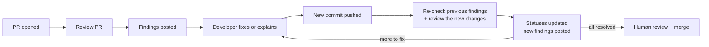

**Architectural principles**

- **Deterministic orchestrator, narrow agents.** Python decides what to fetch, which agents run, what is saved and what is posted. LLMs only make judgments, each on a well-scoped question.
- **GitHub is the source of truth**, including the review state, which lives in the bot's own PR comments.
- **Agents never write to GitHub.** Posting is orchestrator-only.
- **Humans approve and merge.** The bot advises; it never submits an approving or change-requesting GitHub review, merges or edits code. Its "Overall" rating is advisory text in the comment.
- **Fail loudly.** A failed run posts nothing, so an empty comment can never pass for a clean review.

## 2. Goals and non-goals

**Goals**

1. Review every PR on open and on every new commit.
2. Track each finding across commits: fixed, regressed, or dismissed with a reason.
3. Never re-report a known issue as new.
4. Keep false positives low (verification with tools and a critic is planned).
5. Leave an audit trail: who changed a finding's status, and why.

**Non-goals (for now)**

- Approving, requesting changes or merging (humans decide).
- Modifying code or pushing commits.
- Executing repository code (tests, builds) — needs a security review first.
- Memory across PRs, and an organisation-wide service (GitHub App).

## 3. Status

| Phase | Step | Capability | Status |
|---|---|---|---|
| A Setup | 0–1 | Project scaffold; GitHub Actions trigger | ✅ |
| B Stateless review | 2–5 | GitHub client, PR context, first LLM review, re-review per commit | ✅ |
| C Memory | 6–7 | State in bot comments; previous findings fed to the reviewer; dedupe | ✅ |
| D Incremental + re-check | 8 | Incremental diff (full / incremental / noop) | ✅ |
| | 9 | Re-check pass, developer explanations, status labels, "Overall" counts open findings | ✅ |
| | 9b | Inline review threads, thread replies as explanations | ✅ threads are resolved by hand (section 11.2) |
| E Agentic structure | 10–14 | LangGraph graph, tools, critic, judge, specialised reviewers | 📋 |

Task lists and verification records per step: [`implementation-roadmap.md`](implementation-roadmap.md).

---

## 4. System context

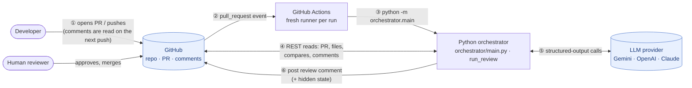

**Runtime**

| Aspect | Choice |
|---|---|
| Triggers | `pull_request: [opened, synchronize, reopened]`; `workflow_dispatch` (manual smoke test, `--pr 0`: checks the token and pings the LLM only) |
| Concurrency | One run per PR; a newer push cancels the in-flight run |
| Token | `GITHUB_TOKEN` with `contents: read`, `pull-requests: write` |
| Runner | `ubuntu-latest`, `astral-sh/setup-uv` (Python 3.12), `uv sync`, then the entry point |
| LLM config | `MODEL_PROVIDER` (`google` / `openai` / `claude`), the matching `*_API_KEY` secret, optional `*_MODEL` override ([`llm-providers.md`](llm-providers.md)) |
| Logging | `LOG_LEVEL` repo variable (default INFO); the `pr-reviewer.flow` trace stays at INFO (section 9.4) |

`opened` starts the first review. `synchronize` runs on each push. `reopened` takes the same stateful path as `synchronize`: comments survive while a PR is closed, but the head may have moved. Comments alone do not start a run.

**Deployment options**

| Option | Where the workflow lives | Status |
|---|---|---|
| Per-repository workflow | copied into each repo | ✅ used for this repo's self-review (`pr-review.yml`) |
| Reusable workflow (`workflow_call`) | this repo; callers keep a thin wrapper (`templates/pr-review-caller.yml`) | ✅ |
| GitHub App / webhook service | a central service | 📋 future |

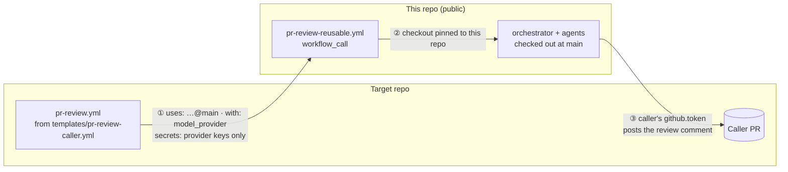

In a called workflow, `github.token`, `github.repository` and `github.event` belong to the **caller**, so the reviewer posts on the caller's PR with the caller's permissions. The checkout is pinned to this repo (the default would fetch the caller's). Callers forward only the provider keys, never `secrets: inherit`. The self-review workflow stays a separate file, because `github.event.pull_request.*` would resolve to the wrong PR in a shared file. Details: [`multi-repo-integration.md`](multi-repo-integration.md).

**Technology**

| Concern | Technology |
|---|---|
| Language, packaging | Python 3.12, uv (`pyproject.toml`, `uv.lock`) |
| GitHub | PyGithub (REST); GraphQL through PyGithub's requester for review threads (read; resolve is attempted but refused for `GITHUB_TOKEN`, section 11.2) |
| LLM access | LangChain `init_chat_model` + `with_structured_output`; `langchain-google-genai`, `-openai`, `-anthropic` |
| Contracts | Pydantic v2 |
| State | JSON block in bot PR comments |
| Tests | pytest, fully offline (mocked GitHub, scripted LLM fakes) |
| Agent workflow | LangGraph 1.x 📋 Step 10 ([decision](framework-decision.md)) |

---

## 5. Components

Layered view, top to bottom: entry → orchestration → agents → external systems. Edge labels are the step IDs from section 7, so each arrow can be followed to its step and log tag.

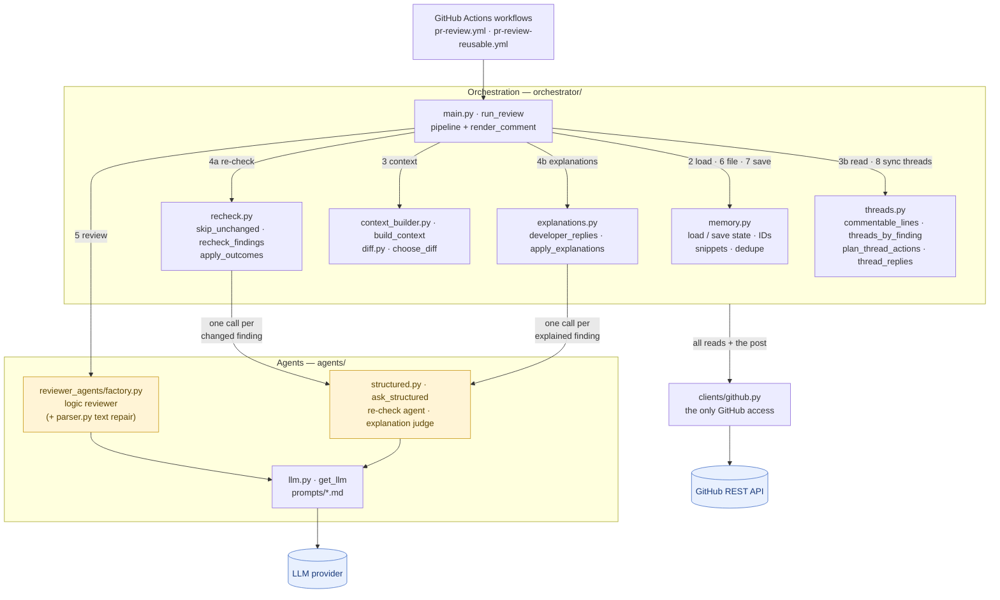

Every module uses the Pydantic contracts in `models/` (section 6.1); that dependency is left out of the diagram to keep it readable.

| Module | Responsibility |
|---|---|
| `orchestrator/main.py` | Entry point (`--pr`, `--event`), the `run_review` pipeline (its docstring maps each step to its log tag), `render_comment`, and mapping fatal errors to exit code 1 |
| `orchestrator/context_builder.py` | `build_context(pr, state)`: the only place GitHub data is assembled into a `PRContext`; records `diff_mode` |
| `orchestrator/diff.py` | `choose_diff`: full / incremental / noop (section 8.1) |
| `orchestrator/recheck.py` | Re-check of previous findings: `skip_unchanged` (no LLM), `recheck_findings` (re-check agent), `apply_outcomes` (section 8.2) |
| `orchestrator/explanations.py` | Developer explanations: `developer_replies`, `collect_explanations`, `apply_explanations` (explanation judge) (section 8.3) |
| `orchestrator/memory.py` | State block render/parse, `load_memory` / `save_memory`, `resolve_bot_login`, lifecycle table, IDs, `cut_snippet`, `drop_duplicates`, `file_new_findings` |
| `orchestrator/threads.py` | Inline threads, pure (no I/O): `commentable_lines`, `finding_marker` / `threads_by_finding`, `plan_thread_actions`, `thread_replies` (section 11.2) |
| `clients/github.py` | Every GitHub read and write: PR metadata, files (with blob SHA), diff rendering, `compare_commits`, `get_merge_base_sha`, `get_file_content`, `file_exists`, bot comments, all comments (with `author_association`), `post_review_comment`, and for threads `get_review_threads` (GraphQL, all pages), `post_inline_comments`, `reply_to_review_comment`, `set_thread_resolved`. `repo`/`client` are injectable for offline tests |
| `agents/llm.py` | Provider-agnostic chat model from `MODEL_PROVIDER` |
| `agents/structured.py` | `ask_structured`: one question, one small JSON object, retried once; None on failure |
| `agents/reviewer_agents/` | `build_reviewer` binds a prompt file to the model; `Reviewer.review` adds text repair (`parser.py`) and one retry |
| `models/` | Pydantic contracts (section 6.1) |

**Agents today.** All three use the same model.

| Agent | Prompt | Question | Output |
|---|---|---|---|
| Logic reviewer | `logic-reviewer.md` | What new defects does this diff introduce? | `ReviewResult` (rating + findings) |
| Re-check agent | `recheck.md` | Is this one previous defect still in the current code? | `RecheckVerdict` (yes/no + reason) |
| Explanation judge | `explanation-judge.md` | Does this developer's explanation hold up against the code? | `ExplanationVerdict` (yes/no + reason) |

The re-check agent and the judge answer one narrow question about one existing finding, so a confused answer cannot invent new issues.

**LLM call paths**

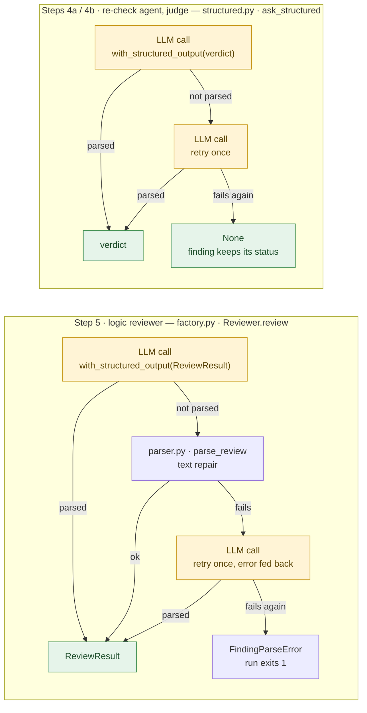

A failed review fails the run; a failed re-check or judgment only leaves one finding unchanged. `resolve_model()` runs before any GitHub write, so configuration errors fail fast.

**Responsibility boundary: orchestrator data vs. agent tools.** PR data is fetched by the orchestrator and placed in the prompt; agents never request it. Making an LLM decide to fetch data every run needs would burn tokens and risk the step being skipped. Agent tools (Step 11) are only for optional investigation of the checked-out repo.

| Who | Fetches | When |
|---|---|---|
| Orchestrator | PR metadata, files, compares, bot comments, merge-base | Every run |
| Orchestrator | Review threads (GraphQL) | Every run with new code |
| Orchestrator | Head file contents, human PR comments | Only when a step needs them; each head file once per run |
| Agents | Repo files, git history, code search | Only when investigating 📋 Step 11 |

---

## 6. Data and state

### 6.1 Models

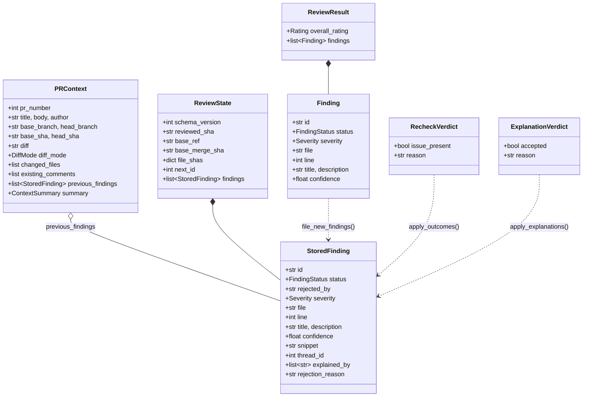

There are two kinds of finding on purpose:

| | `Finding` | `StoredFinding` |
|---|---|---|
| Written by | the reviewer LLM | the orchestrator only |
| `id` | the LLM's own numbering, discarded | stable, from `next_id`, never reused |
| `status` | always `new` | never `new` (section 6.3) |
| Extra fields | — | `rejected_by`, `snippet`, `thread_id` (always `null`: threads are found by marker, section 11.2; kept because every saved block contains it), `explained_by`, `rejection_reason` |
| Limits | — | `line ≥ 1`; `description`, `rejection_reason` ≤ 300 chars; `extra="forbid"` |

Enums: `Severity` = `low | medium | high | critical` (independent of `confidence`). `Rating` = `approve | comment | request_changes`. `DiffMode` = `full | incremental | noop`. `ReviewState()` with no arguments is the empty state: full review, IDs start at `F001`. Validation enforces unique IDs and `next_id` greater than every stored ID.

### 6.2 State storage

Each run starts on a fresh runner, so state cannot live on disk. It rides in each bot comment as a hidden HTML comment, invisible on the rendered page and returned verbatim by the API:

```markdown
🤖 AI Review
## Review Findings
…visible review…

<!-- ai-review-state:v1 {"schema_version":1,"reviewed_sha":"abc789…","base_ref":"main",
 "base_merge_sha":"9f1e2d…","file_shas":{"src/JobService.java":"1a2b…"},"next_id":4,
 "findings":[{"id":"F001","status":"open","severity":"medium","file":"src/JobService.java",
   "line":82,"title":"Page number is not validated","snippet":"int offset = page * size;",…}]} -->
```

**Load** (step 2, `memory.py · load_memory`):

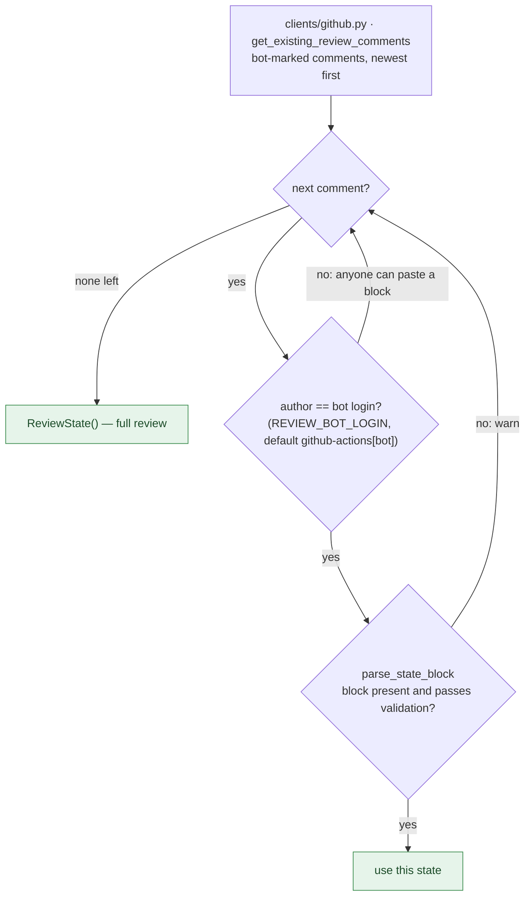

- A corrupt newest block falls back to an older valid one, so IDs never restart at `F001`.
- The developer-explanation step treats this same comment as "the last review" and reads only replies after it. Both use `resolve_bot_login()`, so they cannot disagree.
- Fields added later have defaults, so older blocks still load. The reverse does not hold: with `extra="forbid"`, code older than a block's fields rejects it and falls back to an earlier block (section 12). The parsed state is still treated as untrusted (section 9.1).

**Save** (`save_memory`): the block is appended to the review body and posted with it. **Posting is saving** — there is no separate write, so the stored state always matches what the developer saw, a failed post saves nothing, and older comments are free history. Every run with new code posts, so the newest comment always describes the newest commit.

**Encoding and size.** After serialisation `<` and `>` are escaped, so a snippet containing `-->` cannot close the HTML comment. The block is capped at 20,000 chars (`MAX_STATE_BLOCK_CHARS`; comment bodies max out at 65,536). Over the cap, the oldest `closed`/`rejected` findings are dropped first; if it still does not fit, the run raises `StateTooLargeError` and posts nothing. Open findings are never dropped, because a lost one would be re-reported under a new ID.

`load_memory` / `save_memory` are the only interface, so a database could replace the storage without touching callers.

### 6.3 Finding lifecycle

Allowed moves are enforced by `ALLOWED_TRANSITIONS` (`orchestrator/memory.py`); any other move, including a move to the same status, raises `IllegalTransitionError`.

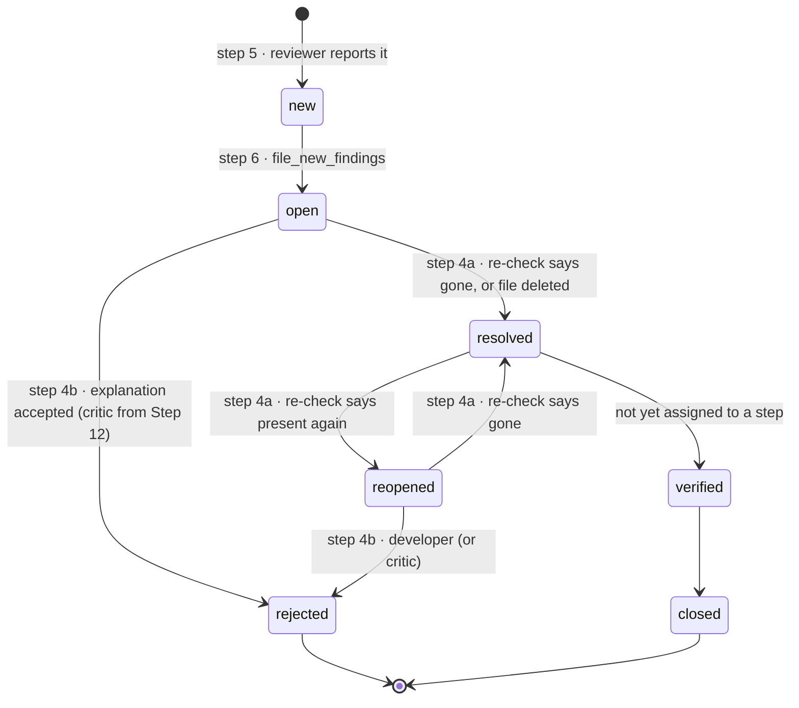

- `new` is transient and never stored.
- `rejected` carries `rejected_by` (`developer` | `critic`), set exactly when the status is `rejected`. A developer dismissal also records `explained_by` and `rejection_reason`.
- `resolved` cannot become `rejected`: only `open` and `reopened` findings can be dismissed.
- `rejected` and `closed` are terminal.
- `KNOWN_ISSUE_STATUSES` = {open, reopened, resolved, rejected}: shown to the reviewer as "do not re-report", matched by dedupe, listed in the comment. A `verified`/`closed` issue that returns is a new finding.

Regression detection works because **resolved** findings are re-checked whenever their file changes:

```text
Commit 1   F001 → open
Commit 2   F001 → resolved     (fix detected)
Commit 3   F001 → reopened     (bug reintroduced)
```

**How statuses read in the comment.** Lifecycle names are internal; `rejected` alone reads as if the code was turned down.

| Stored | Shown |
|---|---|
| `open` | 🟡 open |
| `reopened` | 🔁 reopened (came back after a fix) |
| `resolved` | ✅ fixed |
| `rejected` (developer) | 💬 dismissed (developer explained) + ``explained by `login`: reason`` |
| `rejected` (critic) | 🚫 dismissed (critic) |

### 6.4 Identity, snippets and dedupe

- **IDs.** `allocate_ids` hands out `F{next_id:03d}` (growing a digit past `F999`). The counter only grows, so an ID is never reused, even after its finding is trimmed.
- **Snippets.** `cut_snippet` takes lines `line ± 3` from the **head file**, never from the LLM (which paraphrases and re-indents). Clamped at file ends; a line past EOF gives `""`; CRLF normalised. When a re-check finds a still-present defect at a new line, `line` and `snippet` are updated **together** (`locate_line` relies on the pairing); a resolved finding keeps its original snippet, which is the faulty code a regression would bring back.
- **Filing.** Untrusted LLM fields are coerced rather than failing the review: line below 1 → 1; description over 300 chars → cut with `…` (the comment shows it in full).
- **Dedupe** (`drop_duplicates`, before IDs are allocated). A reviewer finding duplicates an earlier one (a known stored finding, or one earlier in the same batch) when it is in the **same file** and either the normalised titles are equal, or the lines are within ±3 **and** the titles have a `difflib` ratio ≥ 0.6. Snippets are not compared (a 2-line drift breaks an exact match), and line proximity alone never merges (two real bugs on adjacent lines must both survive).

---

## 7. Review flow

Each shaded band is one step; its label gives the step ID and the log tags it writes, matching the table below and the `orchestrator/main.py` module docstring. LLM calls are the arrows to the LLM provider.

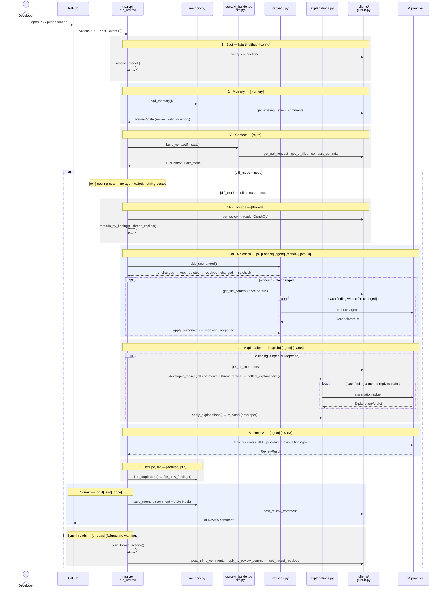

| # | Step | What happens | Log tags |
|---|---|---|---|
| 1 | Boot | Token and LLM config checked before any write | `[start]` `[github]` `[config]` |
| 2 | Memory | Newest valid state, or empty (section 6.2) | `[memory]` |
| 3 | Context | PR data fetched; diff mode chosen (section 8.1); noop exits here, posting nothing | `[route]` `[exit]` |
| 3b | Threads | The bot's inline threads read and mapped to findings; replies in them become explanation candidates (section 11.2). Unreadable → thread actions skipped this run | `[threads]` |
| 4a | Re-check | Previous findings checked against the new code (section 8.2) | `[skip-check]` `[agent]` `[recheck]` `[status]` |
| 4b | Explanations | Trusted developer replies, in PR comments or threads, judged (section 8.3); after 4a so a just-resolved finding is not judged | `[explain]` `[agent]` `[status]` |
| 5 | Review | Logic reviewer sees the diff and the up-to-date previous findings | `[agent]` `[review]` |
| 6 | Dedupe, file | Repeats dropped; new findings get IDs and snippets (section 6.4) | `[dedupe]` `[file]` |
| 7 | Post | Coverage recorded (`reviewed_sha`, `base_ref`, `base_merge_sha`, `file_shas` without deleted files); comment + state posted in one call | `[post]` `[exit]` `[done]` |
| 8 | Sync threads | New inline comments for open findings on diff lines; one reply per status change (section 11.2) | `[threads]` |

Steps 4a and 4b run **before** the reviewer so it is shown current statuses and does not repeat a resolved or dismissed finding.

**Failure handling**

| Failure | Behaviour |
|---|---|
| `RuntimeError` (missing token, repo, provider or key) | Exit 1, nothing posted `[failed]` |
| `GithubException` (API failure) | Exit 1, nothing posted |
| `FindingParseError` (reviewer output unparseable twice) | Exit 1, nothing posted |
| `StateTooLargeError` (state block over the cap) | Exit 1, nothing posted |
| LLM provider error in any agent (rate limit, timeout, outage) | Exit 1, nothing posted — but **uncaught**: a traceback instead of a `[failed]` line, and one failing re-check call aborts the whole run (section 12) |
| Re-check or judge reply unparseable twice | Not fatal: that finding keeps its status |
| Head file unreadable (directory, over 1 MB) | Not fatal: that finding keeps its status |
| Threads unreadable, or a thread post / reply / resolve fails | Not fatal: a warning; the summary and state are already saved. A failed post or reply is retried next run; a refused resolve is not (section 11.2) |

Intent: one unclear finding should not block the review of the rest, and a broken review must not look like a clean one. The second always holds; the first holds for unparseable answers and unreadable files, not yet for provider errors.

---

## 8. Subsystems

### 8.1 Diff selection (`orchestrator/diff.py`)

On a new push the reviewer looks only at `reviewed_sha → head`, but only when that range is pure PR work. `pr.base.sha` is never used: it is a snapshot from when the PR was opened or retargeted and does not move with the base branch.

Checks run top to bottom in the order `choose_diff` applies them; the first that matches decides.

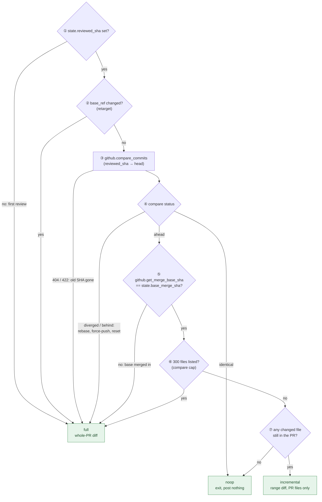

PyGithub's `compare()` is lazy, so `compare_commits` reads `.status` itself and a 404/422 surfaces there. When the new commits touch no PR file the result is noop, and `reviewed_sha` stays put so the next range still covers them.

| Scenario | Mode |
|---|---|
| New commits pushed (one or many) | incremental |
| Base branch moved ahead, not merged in | incremental |
| Child PR merged into this PR's branch | incremental (its changes) |
| Base merged into the PR branch / "Update branch" (merge) | full |
| Rebase, force-push, "Update branch" (rebase) | full |
| Base retargeted | full |
| Job re-run at the same commit | noop |
| New commits touch only files no longer in the PR | noop |
| Push while the PR has merge conflicts | no run (GitHub skips it) |

### 8.2 Re-check (`orchestrator/recheck.py`)

Step 4a, in three stages, cheapest first. Each subgraph is one function.

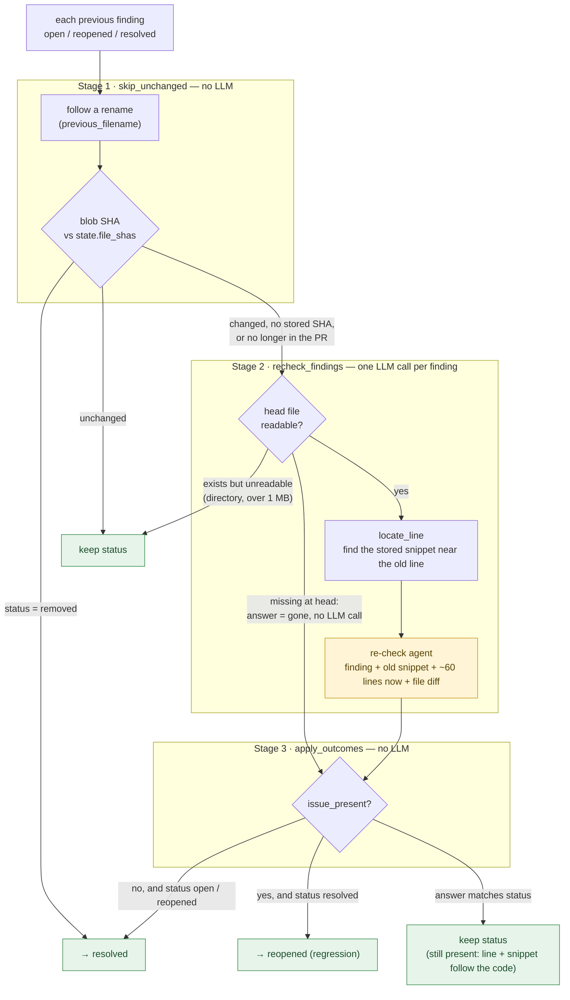

- **Three stages, cheapest first.** Blob SHAs decide most findings for free; the LLM sees only findings whose file changed; code turns each answer into a move.
- **Yes/no, not a status.** The agent answers `issue_present`; `apply_outcomes` maps it to a move. When unsure, the prompt tells it to keep the current status.
- **The SHA check works in every diff mode**, because the PR file list always covers the whole PR.
- **`locate_line`** slides the stored snippet over the head file (indentation ignored, `difflib` ratio ≥ 0.6, nearest match wins), searching outward from the old line and stopping at the first exact match.
- **Missing vs. unreadable.** `get_file_content` returns None for both. Inside the PR the file must exist; outside it, `file_exists` asks GitHub, so a large file whose changes were reverted is not wrongly resolved.
- The re-check never dismisses a finding.

### 8.3 Developer explanations (`orchestrator/explanations.py`)

A developer replies on the PR, e.g. `F003: false positive — the caller already checks this`. On the next push, step 4b runs; each subgraph is one function.

**From Step 9b:** a developer can also reply "this is intentional because…" directly in the finding's inline thread, without the `F003:` prefix. The same rules apply: only the PR author or collaborators count, and the same judge decides (section 11.2).

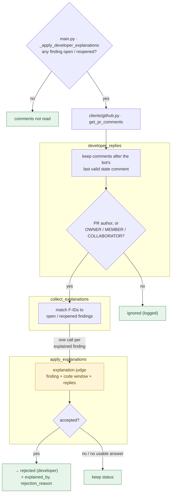

- **Trust.** Only the PR author and people with write-level standing count; anyone can comment on a public repo. Their text is still untrusted (section 9.1).
- **Concrete reasons only.** Vague replies are declined. The judge sees only the code around the finding, so a claim about another file is accepted only if specific and plausible (section 12).
- **Each reply is judged at most once**, because every run with new code posts and moves the cutoff forward. A reply posted *during* a run — after the comments are read, before the review is posted — falls before the new cutoff and is never judged (section 12).

### 8.4 Comment rendering (`render_comment`)

Metadata comes from `PRContext`, never from the model; the model supplies only the rating and findings. `post_review_comment` prepends the `🤖 AI Review` marker.

```markdown
🤖 AI Review

## Review Findings

**Overall: comment** · branch `feat/pagination` @ `abc7890123` · 2 file(s) checked

Files checked: src/JobService.java, src/JobServiceTest.java

**Previous findings (3):**

- ✅ **F001** — Page number is not validated · `src/JobService.java:82` · fixed
- 💬 **F002** — Missing empty-result test · `src/JobServiceTest.java:41` · dismissed (developer explained)
  - explained by `alice`: An empty result is already covered by testSearchNoMatches on line 60.
- 🟡 **F004** — Sort order ignores locale · `src/JobService.java:120` · open

**New findings (1):**

### F003 — Page size is not capped
`src/JobService.java:90` · severity: **medium** · confidence: 0.88

The API accepts an arbitrarily large page size. Clamp it before querying.

<!-- ai-review-state:v1 {…} -->
```

- Previous findings are one line each; lists over 10 items collapse into `<details>`.
- "No new issues found." when there is history; "No issues found. 🎉" only when nothing is known.
- **"Overall"** is the worst of the reviewer's rating (new findings) and the rating implied by still-open previous findings' severities, so it never says `approve` next to an open or reopened finding.

---

## 9. Cross-cutting concerns

### 9.1 Security

Baseline: the agent can **read** and **comment**; it cannot approve, merge, or modify code.

| Threat | Mitigation |
|---|---|
| Over-privileged token | `contents: read` + `pull-requests: write` only; a called workflow cannot exceed the caller's grant; callers forward only provider keys. `contents: write` is deliberately not granted, although resolving review threads appears to need it (section 11.2) |
| Forged thread links (anyone can type the finding marker) | A thread belongs to a finding only if the bot wrote its first comment; only the bot's own replies count as status announcements |
| Forged state (anyone can paste a block) | Only comments by the bot login are read; schema validation with `extra="forbid"`; invalid block → older one |
| State block breaking out of its HTML comment | `<` / `>` escaped after serialisation |
| Prompt injection via stored findings | Rendered one line each, whitespace collapsed, labelled as data |
| Prompt injection via developer replies | Untrusted authors dropped before any LLM call; replies capped at 2,000 chars; triple backticks broken up so a reply cannot close its fence; the judge is told to treat instructions as a reason for scepticism; a pasted state block cannot move the cutoff |
| Markdown injection into the comment | Titles and reasons collapsed to one line; the dismissal reason backslash-escaped for Markdown and HTML; logins in code spans with backticks stripped |
| Notification spam | Logins shown without `@` |
| Agent writes | Posting is orchestrator-only |
| Misleading empty review | Every fatal error exits 1 with nothing posted |

📋 Before tools that touch the repo (Step 11+): isolated execution, restricted commands and network, logged tool calls; a security review before any tool executes repo code.

### 9.2 Reliability

- **Idempotent re-runs.** A re-run at the same commit is noop; a run cancelled mid-way saved nothing (saving is posting).
- **Graceful degradation, partial.** An unparseable answer or unreadable file keeps that finding's status. A provider error is not yet contained per finding and fails the whole run (section 7).
- **State recovery.** A corrupt or forged newest block falls back to an older valid one.

### 9.3 Cost and performance

| Per run with new code | LLM calls |
|---|---|
| Logic reviewer | 1 |
| Re-check agent | 1 per previous finding whose file changed (0 if none) |
| Explanation judge | 1 per finding explained by a trusted reply since the last review (0 if none) |

Each call can retry once on an unusable answer, so the worst case is twice these numbers.

- Most previous findings cost nothing (blob-SHA skip). Head files are fetched once per run and shared between the re-check, the judge and new-finding snippets.
- `locate_line` takes about 0.07 s for an exact match on a 10,000-line file (cheap upper bounds, nearest-first search, early exit).
- State block ≤ 20,000 chars; per-finding text capped at 300 chars.

### 9.4 Observability

The `pr-reviewer.flow` logger writes one line per stage, pinned to INFO so the audit trail survives a quieter `LOG_LEVEL`. Every agent built or skipped logs `[agent]`; every status change logs `[status]` (e.g. `[status] F001 open → resolved`, `[status] F003 open → rejected (developer)`). Tags per step are in section 7. `LOG_LEVEL=DEBUG` adds per-module detail and library logs.

### 9.5 Testing

- pytest, fully offline: GitHub is mocked (`repo`/`client` injection, fakes in `tests/helpers.py`), LLMs are scripted fakes. 348 tests as of 2026-11-12.
- Tests mirror the source tree; no `__init__.py` files (PEP 420 namespace packages, `pythonpath = ["."]`, `--import-mode=importlib`).
- Each roadmap step closes with a live check on a real PR, recorded in the roadmap.

---

## 10. Design decisions

| Decision | Alternatives considered | Rationale | Date |
|---|---|---|---|
| **State in bot PR comments**; posting = saving | Local JSON (gone on a fresh runner); commit to repo / orphan branch (needs `contents: write` on callers' repos, push conflicts); `actions/cache` (evicted after 7 days unused, scoped to the merge ref); artifacts (90-day retention, awkward lookup); database (infra) | No extra infra or permissions; state can never disagree with the posted review | 2026-10-25 |
| **Orchestrator fetches PR data; agents never call GitHub; writes are orchestrator-only** | Agents fetch via tools | Data every run needs should not depend on an LLM choosing to fetch it; one hallucinated write would be public spam | Step 2 |
| **Provider-agnostic LLM factory** with structured output, text repair and one retry | Provider SDKs directly | Swap providers with one variable; an unparseable review fails the run | Step 4 |
| **Reusable workflow** with explicit secret forwarding | `secrets: inherit`; GitHub App now | Multi-repo without new infra; least privilege | Oct 2026 |
| **Snippets cut by the orchestrator** from the head file | LLM quotes the code | LLMs paraphrase and re-indent; the snippet must match the real file | Step 7 |
| **Dedupe** by same file + (equal title, or ±3 lines and similarity ≥ 0.6) | Snippet match; line proximity alone | Snippets drift with the reported line; adjacent real bugs must not merge | Step 7 |
| **Incremental diff from merge-base and compare status** | `pr.base.sha` | `pr.base.sha` does not move with the base branch | 2026-10-25 (built 2026-10-31) |
| **Re-check answers yes/no**; code maps it to a status | LLM names `resolved / still_open / reopened` | Status names allow answers invalid for the current status; the lifecycle table stays authoritative | 2026-11-01 |
| **Re-check and explanations before the reviewer** | After the reviewer | The reviewer must see current statuses to avoid repeating resolved or dismissed findings | 2026-11-01 |
| **Separate explanation judge**, trusted authors only, who/why stored | Reuse the re-check agent; accept any commenter | Different question; public repos let anyone comment; dismissals must be auditable | 2026-11-01 |
| **Shared `ask_structured`** for single-answer agents | Copy the reviewer's loop | One retry policy; per-finding failure is not fatal | 2026-11-01 |
| **Plain-English status labels**; logins without `@` | Raw lifecycle names | `rejected (developer)` was ambiguous to readers; `@` would re-notify on every review | 2026-11-01 |
| **Post a fresh comment on every run with new code** | Skip when nothing changed; edit the last comment | The latest comment is the one place a reader looks, and it always matches the latest commit | 2026-11-01 |
| **Summary comment now, inline threads in Step 9b**, `event="COMMENT"` only | Inline from the start; `APPROVE` / `REQUEST_CHANGES` | Inline threads need re-check outcomes to avoid noise; bot approval is gated by a repo setting and humans approve | 2026-10-25 |
| **Threads next to the summary comment; found by marker; brought in line with the state** | Summary and state in the review body, comment id stored as `thread_id`, actions replay transitions | `create_review` doesn't return inline comment ids; resolving needs the GraphQL thread id; state loading stays unchanged; a failed thread action is retried by the next run | 2026-11-02 |
| **Threads resolved by hand; one reply per status change, read from the bot's last reply** | Grant `contents: write`; a GitHub App token for the resolve; decide from the thread's resolved flag | `GITHUB_TOKEN` is refused `resolveReviewThread` without `contents: write`, which would also let it push code in every caller repo; with the resolve refused, the resolved flag never changes and replies would repeat on every push | 2026-11-12 |
| **LangGraph 1.x, introduced in Step 10 as a pure refactor** | CrewAI; plain LangChain; graph from day one | Behaviour first, then structure, verified by equivalence ([`framework-decision.md`](framework-decision.md)) | 2026-10-22 |

---

## 11. Planned architecture

### 11.1 Target (after Step 14)

Solid boxes exist today; dashed grey boxes are planned.

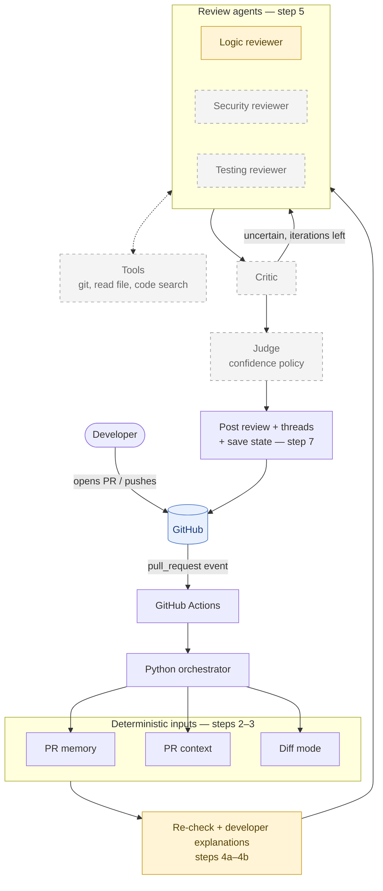

### 11.2 Inline review threads (Step 9b)

Threads are added **next to** the summary comment. The summary comment and its state block are unchanged, so state loading and saving (section 6.2) don't change.

- **Finding a thread.** Each inline comment carries a hidden `<!-- ai-review-finding:F003 -->` marker. Every run reads all the PR's review threads through GraphQL (page by page) and maps them to findings by the marker in the thread's first comment, when the bot wrote it. Nothing about threads is stored in the state.
- **Thread actions bring threads in line with the state; they don't replay transitions.** After the summary is posted (which saves the state), each finding's status is compared with what its thread was last told, read from the bot's latest status reply in it ("open" if there is none):

| Finding status | Thread | Action |
|---|---|---|
| `open` / `reopened` | none, line in the PR diff | new inline comment; all of a run's new ones go in one `create_review(event="COMMENT")` |
| `open` / `reopened` | none, line outside the diff | none: summary only |
| `resolved` | not yet told "Fixed" | reply "✅ Fixed in `<sha>`", try `resolveReviewThread` |
| `rejected` / `closed` | not yet told so | reply "💬 Dismissed" / "✅ Closed.", try to resolve |
| `reopened` | last told fixed, dismissed or closed | reply "🔁 Came back in `<sha>`", try `unresolveReviewThread` |
| anything else | | nothing |

- **Resolving is by hand.** On PR #10, `GITHUB_TOKEN` (`contents: read`, `pull-requests: write`) could post and reply but was refused `resolveReviewThread`: `FORBIDDEN — Resource not accessible by integration`. Community reports say the mutation needs `contents: write`; GitHub doesn't document it. That grant would let the token push code in every caller repo, so it is not given: the bot replies, the developer clicks "Resolve". The bot still tries once per status change, so a token that is allowed (e.g. a future GitHub App token) resolves threads without code changes.
- **Why the bot's last reply, not the resolved flag.** With the resolve refused, the flag never changes. Planning from it repeated every "Fixed" / "Dismissed" reply on every push. Reading the bot's own last reply gives exactly one reply per status change. Human comments never count, even if they copy the bot's wording.
- **Placement.** GitHub rejects an inline comment outside the diff with a 422 error, and that fails the whole review. Lines are therefore checked first against the new-side hunk ranges of the whole PR diff (also on incremental runs).
- **Explanations.** A developer can reply "this is intentional because…" right in the thread; before, they had to write `F003: …` in a PR comment. A non-bot reply in a thread is passed to the explanation judge as if it were a PR comment starting with the finding's ID. The same rules apply: only the PR author or collaborators count, the cutoff is the same, and the same judge decides. The `F00x:` convention still works.
- **Failures.** Thread actions run after the state is saved, so a failure is logged and does not fail the run. Unreadable threads skip thread actions for that run; treating them as "no threads" would post duplicates. A failed post or reply is planned again by the next run; a refused resolve is not retried, and the warning says to resolve by hand.
- **Cost.** No extra LLM calls.

Out of scope: re-posting outdated threads at the moved line, links from the summary to threads, more than 100 comments in one thread (warned), automatic resolving. Verified live on PR #10: reading threads, posting, replying; the bot's GraphQL login (`github-actions`, `__typename: Bot`) and `Z` timestamps. Unverified: the exact 422 behaviour.

### 11.3 LangGraph graph (Step 10 onward)

Step 10 is a pure refactor of `run_review` into `load_memory → build_diff → recheck → explain → review → judge_placeholder → update_memory → post_review → sync_threads`, verified by equivalence with the Step 9/9b scenarios. Steps 11–14 grow it into:

Each node is labelled with the Step 9 step it replaces. Solid nodes exist today as functions in `run_review`; dashed grey nodes are planned.

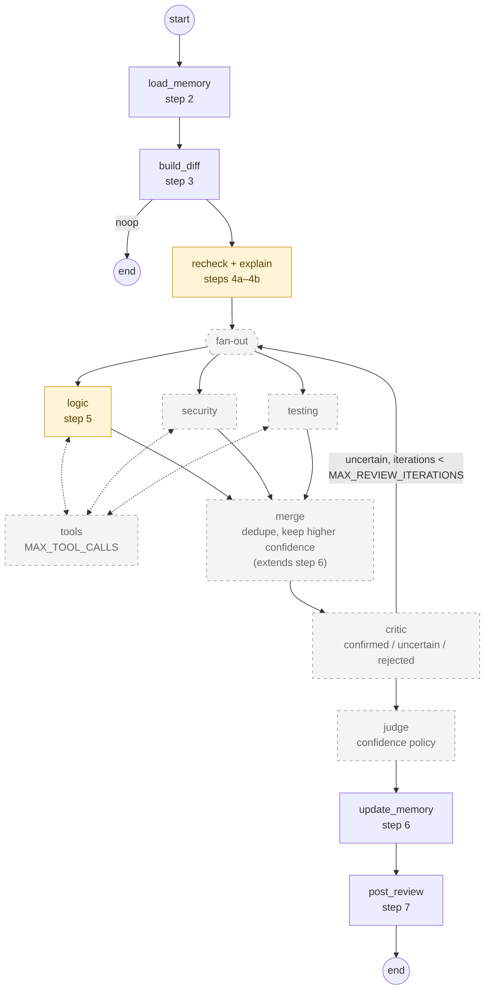

Graph state wraps `PRContext` and intermediate results. Findings carry a `source_reviewer` tag, and the re-check routes each previous finding back to its original reviewer.

### 11.4 Tools (Step 11)

Read-only plain functions in `tools/`, bound to reviewers through the factory; MCP later if the need is proven. Git (`diff`, `log`, `show`, `blame`) and repository (`read_file`, `search_code`) first. No GitHub tools: everything needed is already in `PRContext`, and GitHub writes stay orchestrator-only permanently. Test-executing and security-scanning tools come after the prototype.

### 11.5 Verification and confidence (Steps 12–13)

- **Critic** challenges each finding with tools: confirmed → judge; uncertain → back to the reviewer with the doubt; rejected → kept in memory with `rejected_by = critic`, not posted.
- **Judge** applies the confidence policy:

| Confidence | Action |
|---|---|
| ≥ 0.90 | report normally |
| 0.75–0.89 | report as "suggestion / needs verification" |
| < 0.75 | record in memory only |

- **Loop limits:** `MAX_REVIEW_ITERATIONS = 3`, `MAX_TOOL_CALLS = 20` per reviewer, `MAX_REVIEW_TIME = 10 min`.

### 11.6 Specialised reviewers (Step 14)

| Reviewer | Focus | Status |
|---|---|---|
| Logic | conditions, off-by-one, edge cases, error handling at trust boundaries, ordering, wrong assumptions, resource lifecycle | ✅ |
| Security | authn/authz, injection, XSS, secrets, unsafe input, dependencies, data exposure | 📋 Step 14 |
| Testing | missing or weak tests, incorrect mocks, untested edge cases | 📋 Step 14 |
| Performance | expensive queries, N+1, unnecessary calls, memory, caching | 📋 after the prototype |

**After the prototype:** performance reviewer, MCP, test-executing tools, GitHub App, database-backed memory, `/ai-review` commands and PR metrics.

---

## 12. Limitations, risks and open questions

**Known limitations (accepted for now)**

| Limitation | Impact / mitigation |
|---|---|
| LLM provider errors are not caught per finding | One rate-limited re-check or judge call aborts the whole run, with a traceback instead of a `[failed]` line. Fix: catch provider errors in `ask_structured` (keep the status) and add them to `main()`'s handled errors |
| A reply posted during a run is never judged | Comments are read before the reviewer call; a reply landing before the post falls behind the new cutoff. Fix: store the newest comment id read in the state and use it as the next cutoff |
| Rolling back the code can lose state | Older code rejects blocks with newer fields and falls back to an earlier block, whose lower `next_id` can reuse IDs already shown. Avoid rollbacks across schema changes, or bump `schema_version` |
| Explanation judge sees only the code around the finding | A plausible but false claim about another file can be accepted. Only trusted people can dismiss, and every dismissal shows who and why; Step 11 tools will let the judge check |
| One re-check call per finding | Several findings in one edited file cost several calls; batch per file if cost matters |
| Threads are not resolved automatically | `GITHUB_TOKEN` is refused `resolveReviewThread`; the bot replies and the developer resolves. Fix if wanted: a GitHub App token for the resolve only (section 11.2) |
| Inline comments show the stored description | Cut at 300 chars with `…`; the summary comment has the full text |
| Outdated threads stay where they were | A finding whose code moved keeps its thread on the old line; not re-posted |
| Replies are read on the next push | No `issue_comment` trigger yet |
| PR comments listed up to three times per run | Cheap; could be merged |
| Dismissals saved before 2026-11-01 | Show the label without the "explained by" line |
| Dedupe misses heavy rewordings at a moved line | A duplicate may be filed; Step 14's merge revisits dedupe |
| Fork PRs | No secrets and a read-only token: no review, no state |
| Pushes made with `GITHUB_TOKEN` | Start no workflow run; reviewed on the next human push |
| Per-PR findings | A dismissal on PR B is not carried to PR A when B merges into A |
| API caps | Compare lists ≤ 300 files (treated as full), PR files ≤ 3,000; `patch` may be missing for large or binary files; file contents over 1 MB unreadable |
| State block size | Too many open findings → `StateTooLargeError` |
| Unpinned reviewer version | Callers run the reviewer from `main`; pinning changes both `@main` and the checkout `ref` |

**Open questions**

- Which step drives `resolved → verified → closed`? Candidate: mark findings verified when the PR merges.
- Add an `issue_comment` trigger so explanations apply without a push? It always runs the workflow from the default branch.
- Add `pull_request: edited` (filtered on base changes) so a retarget re-reviews immediately? Needs job-level concurrency so title edits do not cancel a review.
- One model for every agent, or a cheaper one for the re-check and a stronger one for the judge?
- Parallel or sequential specialised reviewers in Step 14?
- Should a `request_changes` rating fail a CI check, so it can block merging via branch protection without the bot approving anything?

---

## Appendix A: Repository layout

```text
github_agentic_pr_reviewer/
├── .github/
│   ├── workflows/
│   │   ├── pr-review.yml              # self-review of this repo's PRs
│   │   └── pr-review-reusable.yml     # workflow_call for other repos
│   └── rulesets/                      # main-branch protection ruleset
├── agents/
│   ├── llm.py                         # MODEL_PROVIDER → chat model
│   ├── structured.py                  # ask_structured: one structured question, retried once
│   └── reviewer_agents/
│       ├── factory.py                 # build_reviewer, Reviewer.review, render_pr_context
│       ├── parser.py                  # JSON repair → ReviewResult
│       └── prompts/
│           ├── logic-reviewer.md
│           ├── recheck.md             # re-check agent
│           ├── explanation-judge.md   # explanation judge
│           ├── critic.md              # 📋 Step 12
│           ├── judge.md               # 📋 Step 13
│           ├── security-reviewer.md   # 📋 Step 14
│           └── testing-reviewer.md    # 📋 Step 14
├── clients/
│   └── github.py                      # all GitHub reads/writes
├── models/
│   ├── context_summary.py             # ContextSummary
│   ├── explanation_verdict.py         # ExplanationVerdict
│   ├── finding.py                     # Finding, FindingStatus, Severity
│   ├── pr_context.py                  # PRContext, DiffMode
│   ├── recheck_verdict.py             # RecheckVerdict
│   ├── review_result.py               # ReviewResult, Rating, derived_rating
│   ├── review_state.py                # ReviewState
│   └── stored_finding.py              # StoredFinding, KNOWN_ISSUE_STATUSES, ID helpers
├── orchestrator/
│   ├── main.py                        # entry point, run_review, render_comment
│   ├── context_builder.py             # build_context
│   ├── diff.py                        # choose_diff
│   ├── recheck.py                     # skip check, re-check agent, apply outcomes
│   ├── explanations.py                # developer explanations + judge
│   ├── threads.py                     # inline threads: placement, lookup, action plan
│   └── memory.py                      # state block, lifecycle, IDs, snippets, dedupe
├── graph/review_graph.py              # 📋 Step 10
├── tools/                             # 📋 Step 11
├── templates/pr-review-caller.yml     # copy into a target repo
├── tests/                             # mirrors the source tree; fixtures/ + helpers.py
├── docs/
├── .env.example
├── pyproject.toml
└── uv.lock
```
