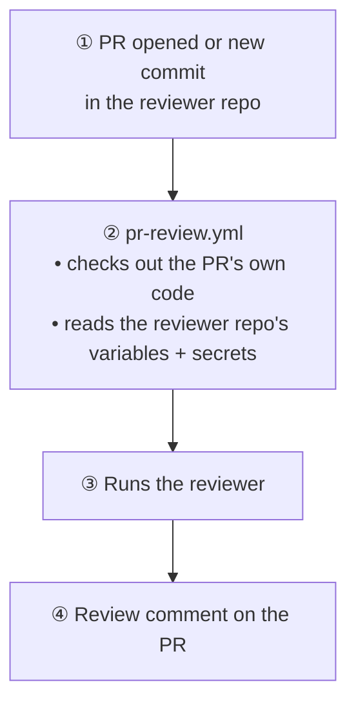
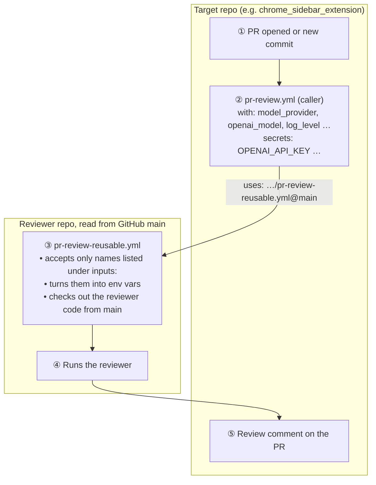
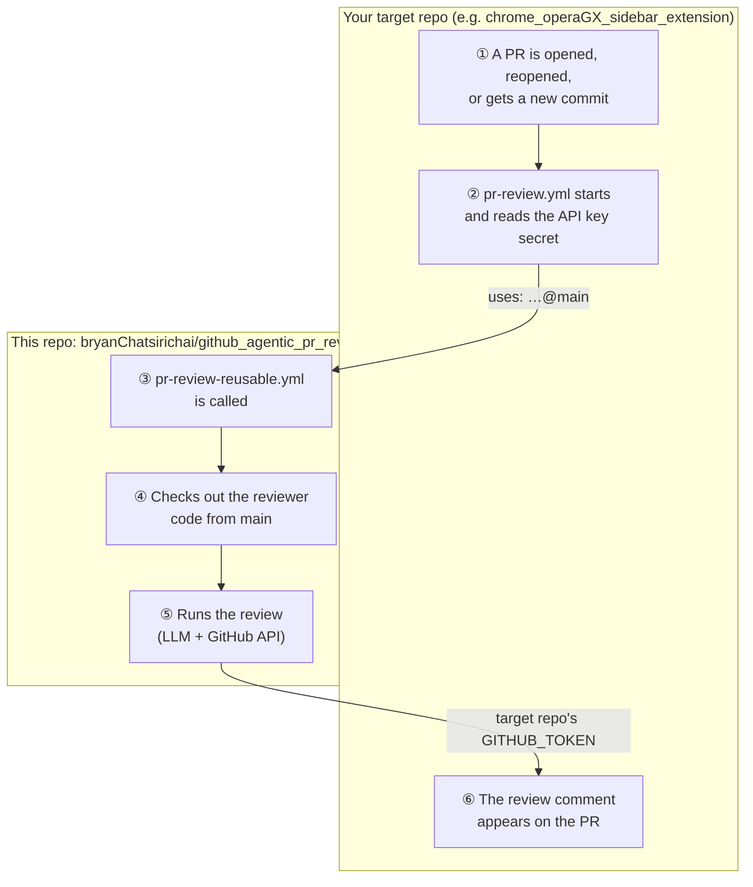
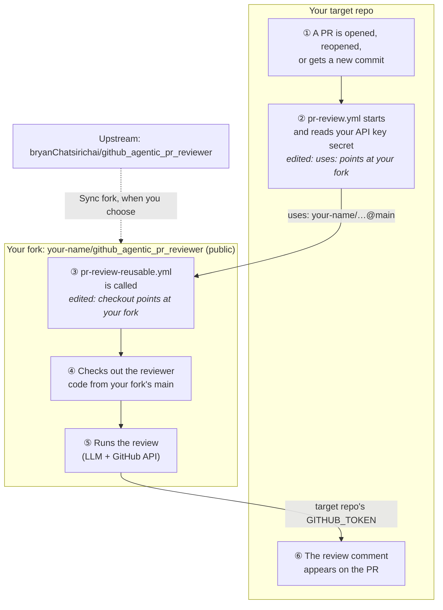

# Using the reviewer on other repositories

The reviewer can review pull requests (PRs) in **any GitHub repository**. This
guide shows how to set that up.

**Terms used in this guide**

| Term | Meaning |
|---|---|
| **Target repo** | The repo whose PRs you want reviewed, e.g. your app's repo. |
| **Reviewer repo** | The repo that holds the reviewer code: this repo, or your fork of it. |
| **Caller workflow** | `.github/workflows/pr-review.yml` in the target repo, a copy of [`templates/pr-review-caller.yml`](../templates/pr-review-caller.yml). It runs on each PR and calls the reusable workflow. |
| **Reusable workflow** | [`.github/workflows/pr-review-reusable.yml`](../.github/workflows/pr-review-reusable.yml) in the reviewer repo. It downloads the reviewer code, runs the review, and posts the result on the target repo's PR. |
| **`your-name`** | A placeholder. Replace it with your own GitHub user name. |

## How it works: two flows

The reviewer runs in two ways. Each uses different workflow files and reads
settings from a different repo.

### Flow 1: the reviewer repo reviews its own PRs

**One file:** [`.github/workflows/pr-review.yml`](../.github/workflows/pr-review.yml)
in the reviewer repo.



It checks out the PR's own code, so a PR that changes the reviewer is reviewed
by its own changes.

### Flow 2: another repo calls the reviewer

**Two files, one in each repo:**

| File | Repo | Job |
|---|---|---|
| `.github/workflows/pr-review.yml` (copy of [`templates/pr-review-caller.yml`](../templates/pr-review-caller.yml)) | Target repo | Starts on a PR, reads the target repo's variables and secrets, and passes them on |
| [`.github/workflows/pr-review-reusable.yml`](../.github/workflows/pr-review-reusable.yml) | Reviewer repo | Receives the values, checks out the reviewer code from `main`, and runs the review |



The reviewer repo's own variables and secrets are **not** used in this flow.
Everything comes from the target repo.

### Side by side

| | Flow 1: self-review | Flow 2: another repo |
|---|---|---|
| Workflow files | 1: `pr-review.yml` | 2: the caller in the target repo and `pr-review-reusable.yml` in the reviewer repo |
| Settings come from | The reviewer repo | The target repo |
| Reviewer code that runs | The PR's own code | The reviewer repo's `main` on GitHub |
| Adding a new setting (e.g. `LOG_LEVEL`) | Add one `env:` line | Add it to **both** files and merge the reviewer repo first (see below) |

### Adding a new setting to Flow 2

The caller can only pass values the reusable workflow lists under `inputs:`.
GitHub rejects anything else with `Invalid input, <name> is not defined in the
referenced workflow`, before the job starts. So a new setting needs three
changes, in this order:

1. **Reviewer repo, `pr-review-reusable.yml`:** add the input under `inputs:`,
   and map it in the `env:` block of the "Run PR reviewer" step, e.g.
   `LOG_LEVEL: ${{ inputs.log_level }}`.
2. **Merge that to the reviewer repo's `main`.** Callers always use the
   version on GitHub's `main`, not a local copy or another branch.
3. **Target repo, caller workflow:** pass the value, e.g.
   `log_level: ${{ vars.LOG_LEVEL }}`. Also update
   [`templates/pr-review-caller.yml`](../templates/pr-review-caller.yml) so
   new repos get it.

Secrets work the same way, through the `secrets:` blocks in both files.

## Which setup do I need?

| You are… | Use | Reviewer repo |
|---|---|---|
| The owner of this repo, setting it up on your own repos | [A. Owner setup](#a-owner-setup) | This repo |
| Anyone else | [B. Fork setup](#b-fork-setup) | Your own fork of this repo |

Don't point your repos at this repo directly if you are not its owner. Your API
key would run whatever is on this repo's `main`, and every change here would
reach you immediately. A fork lets you choose when to take updates.

## Before you start

- **Admin access to the target repo.** You need it to add secrets and change
  Actions settings.
- **GitHub Actions enabled in the target repo.** Check Settings → Actions →
  General → *Actions permissions*.
- **An API key** for one provider: Google (Gemini), OpenAI, or Anthropic
  (Claude). See [`llm-providers.md`](llm-providers.md) for help choosing one.

## Where the API key goes

The rule is the same for both setups: put the API key in **the target repo**
(the repo being reviewed).

| Repo | Needs the API key? | Why |
|---|---|---|
| **Target repo** | **Yes**, plus the `MODEL_PROVIDER` variable | Its caller workflow reads them and passes them to the reviewer. |
| **Reviewer repo** | **No** | A reusable workflow only gets the secrets and values the caller passes in. It never reads its own repo's secrets or variables. |

There is one exception. If you also want the reviewer repo to **review its own
PRs** (with its own `pr-review.yml`), that repo needs a `MODEL_PROVIDER` repo
variable and the matching key secret too. Most fork users can skip this.

---

## A. Owner setup

How a review runs:



### Once, in the reviewer repo

1. **Keep the repo public.** The reusable workflow downloads its own code using
   the target repo's token, and that token can't read other private repos.
2. **Keep the `main` ruleset active** ([`.github/rulesets/`](../.github/rulesets/)).
   Every target repo runs this repo's `main` with its API key, so only you
   should be able to change it.

### For each target repo

1. **Add the API key secret and the provider variable.** In the target repo,
   go to Settings → Secrets and variables → Actions. Add the key on the
   *Secrets* tab and `MODEL_PROVIDER` on the *Variables* tab, with the exact
   names for your provider:

   | Provider | Secret name | `MODEL_PROVIDER` variable | Optional model variable |
   |---|---|---|---|
   | Google (Gemini) | `GOOGLE_API_KEY` | `google` | `GOOGLE_MODEL` |
   | OpenAI | `OPENAI_API_KEY` | `openai` | `OPENAI_MODEL` |
   | Anthropic (Claude) | `ANTHROPIC_API_KEY` | `claude` | `CLAUDE_MODEL` |

   To switch provider later, add the other key and change `MODEL_PROVIDER`.
   The workflow file doesn't change.

2. **Optional: choose a model or log level.** On the *Variables* tab, add the
   model variable from the table, or `LOG_LEVEL` = `DEBUG` for detailed logs.
   Leave them out to use the provider's default model and INFO logs.
3. **Require approval for outside PRs.** Go to Settings → Actions → General →
   *Approval for running fork pull request workflows* and choose **Require
   approval for all external contributors**. Workflows on PRs from strangers
   then wait until you approve them.
4. **Add the caller workflow.** On a new branch, copy
   [`templates/pr-review-caller.yml`](../templates/pr-review-caller.yml) to
   `.github/workflows/pr-review.yml`. No edits are needed. It reads everything
   from the variables and secrets in steps 1–2.
5. **Open a PR from that branch.** The PR that adds the file triggers its own
   review, so you can [check that it works](#check-that-it-works) before
   merging. Then merge it.

---

## B. Fork setup

How a review runs (the two *edited* boxes are the only changes you make):



### Step 1: Fork the reviewer (once)

1. On GitHub, open `bryanChatsirichai/github_agentic_pr_reviewer` and click
   **Fork**. Keep the fork **public**.
2. In your fork's `main` branch, edit
   [`.github/workflows/pr-review-reusable.yml`](../.github/workflows/pr-review-reusable.yml).
   Find the step named "Check out reviewer code" and change `repository:` to
   your fork:
   ```yaml
   - name: Check out reviewer code
     uses: actions/checkout@v4
     with:
       repository: your-name/github_agentic_pr_reviewer   # ← was bryanChatsirichai/…
       ref: main
   ```
   Without this change, your fork would still download and run the upstream
   code.
3. **Recommended: protect your fork's `main`.** Go to Settings → Rules →
   Rulesets → *New ruleset* → *Import a ruleset*, and import
   [`.github/rulesets/main-branch-protection.json`](../.github/rulesets/main-branch-protection.json).
   Before importing, change `actor_id` in the file to your own GitHub user ID,
   which you can find at `https://api.github.com/users/your-name` (the `id`
   field).

### Step 2: Set up each target repo

1. Do steps 1–3 of the [owner setup's per-repo list](#for-each-target-repo):
   add the API key secret and `MODEL_PROVIDER` variable, optionally choose a
   model, and require approval for outside PRs.
2. On a new branch, copy
   [`templates/pr-review-caller.yml`](../templates/pr-review-caller.yml) to
   `.github/workflows/pr-review.yml`. Change the `uses:` line to your fork:
   ```yaml
   uses: your-name/github_agentic_pr_reviewer/.github/workflows/pr-review-reusable.yml@main
   ```
3. Open a PR from that branch. It triggers its own review, so you can
   [check that it works](#check-that-it-works). Then merge it.

### Getting updates from upstream

Click **Sync fork** on your fork's GitHub page whenever you want the latest
reviewer code. Your target repos use it from their next run.

After syncing, **check that the `repository:` line from Step 1.2 still points
at your fork**. If GitHub reports a conflict and offers to discard your
commits, that also discards this edit. Redo it after syncing.

---

## Check that it works

1. In the target repo, open the **Actions** tab and click the latest
   **pr-review** run.
2. Open the **Run PR reviewer** step. A successful run ends with a line like:
   ```text
   [done] exit 0 — review posted, 3 LLM call(s)
   ```
   `skipped, nothing new` instead of `review posted` is also a success. It
   means the code hasn't changed since the last review.
3. Go back to the PR. A review comment from `github-actions` should be there.

## Troubleshooting

| What you see | Likely cause | Fix |
|---|---|---|
| No **pr-review** run appears for the PR | The PR has merge conflicts (GitHub doesn't run `pull_request` workflows on conflicted PRs), or the file isn't at `.github/workflows/pr-review.yml` | Resolve the conflicts, or check the file path |
| The run shows **Skipped** | The PR comes from a fork. The template's `if:` skips those on purpose | Expected. Only branches inside the target repo are reviewed |
| The PR shows **Approve workflows to run** | An outside contributor opened it (setup step 3) | Expected. Approving it still won't run a review, because the job is skipped |
| The run fails right away with `Invalid input, <name> is not defined in the referenced workflow` | The caller passes a value the reviewer repo's `main` doesn't accept yet | Merge the reviewer repo change first ([Adding a new setting](#adding-a-new-setting-to-flow-2)), or remove that line from the caller |
| The run fails right away, mentioning the called workflow | The `uses:` path, owner or `@main` is wrong | Compare the `uses:` line with the template, character by character |
| **Check out reviewer code** fails | Fork users: `repository:` in your fork's reusable workflow is wrong, or the fork isn't public | Redo [Step 1.2](#step-1-fork-the-reviewer-once) |
| Log says `MODEL_PROVIDER is not set` or `is not a known provider` | The `MODEL_PROVIDER` variable is missing, misspelled, or was added as a secret instead of a variable | Add it on the target repo's *Variables* tab: `google`, `openai` or `claude` |
| Log says `GOOGLE_API_KEY is not set` (or the OpenAI / Anthropic name) | The key for the provider in `MODEL_PROVIDER` is missing, has a different name, or was added to the reviewer repo instead | Add it to the **target repo** with the exact name from the provider table. The key must match `MODEL_PROVIDER` |
| Log says the model was not found | The model variable (e.g. `OPENAI_MODEL`) names a model your provider account can't use | Fix or delete the variable. Deleting it uses the default model |
| VS Code warns `Context access might be invalid` | The editor can't find that secret on GitHub, usually a provider you don't use | Harmless. Missing secrets are passed as empty strings |
| Log ends with `[failed] exit 1, nothing posted` | An error during the review. The text after `—` names it | Read that message. For a provider error, check the key and your account's quota |
| Posting fails with `403` / `Resource not accessible by integration` | The `permissions:` block was removed or changed in the caller workflow | Restore `contents: read` and `pull-requests: write` |

---

## Who can trigger a review

| Who | Triggers a review? | Why |
|---|---|---|
| The repo owner and collaborators with write access | Yes | They can push branches to the target repo |
| An outsider opening a PR from a fork | No | GitHub waits for your approval ([setup step 3](#for-each-target-repo)). If you approve it, the template's `if:` skips the job. Even if the PR removes that line, the run gets **no secrets** and a **read-only** token |
| Anyone else | No | Pushing branches and running workflows by hand both need write access |

The real protection is GitHub's own rule for fork PRs: no secrets and a
read-only token. The `if:` line only skips those runs early. It can't be the
protection, because `pull_request` runs the workflow file *from the PR*, so a
fork PR can edit it.

**Never** change the trigger to `pull_request_target`, and never add an
`issue_comment` trigger without an author check. Both run with your secrets on
PRs from outsiders.

## Good to know

| Topic | Detail |
|---|---|
| Permissions | The caller job must grant `contents: read` and `pull-requests: write`. A reusable workflow can't give itself more than the caller grants. |
| Secrets | The caller passes only the API key secrets. Don't use `secrets: inherit`, which would pass every secret in the target repo. |
| Upgrade timing | Target repos always run the reviewer repo's `main`. To control upgrades, replace `@main` in `uses:` *and* `ref: main` in the reusable checkout with the same tag or commit SHA. |
| Manual run | The **Run workflow** button only appears once the file is on the target repo's default branch. A manual run has no PR, so it only runs a smoke test that checks the GitHub token and the API key. |
| Debug logs | Set the target repo's `LOG_LEVEL` variable to `DEBUG`. Unset means INFO. |
| Why two workflow files | The reviewer repo reviews itself with `pr-review.yml` and serves other repos with `pr-review-reusable.yml`. A single shared file would read `github.event.pull_request.*` from the wrong PR. |
