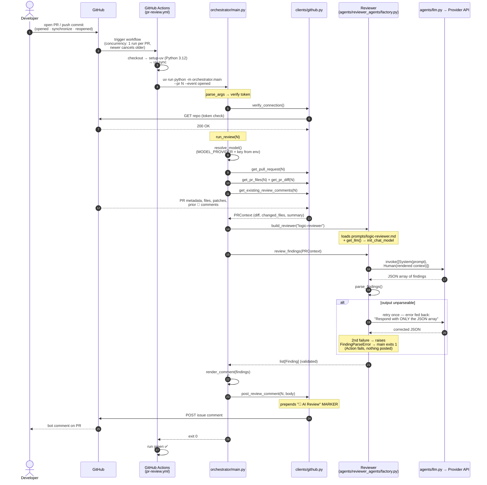

# Review Flow — Sequence Diagram

> **What this shows:** the end-to-end sequence when a GitHub Action runs a
> review — from PR event to posted `🤖 AI Review` comment, as of Step 4
> (stateless first review; memory, incremental diff, and re-check arrive in
> later steps).
>
> **Companion to:** `implementation-roadmap.md` (Step 4) and
> `agentic-pr-review-system-design.v1.md` (§29 first implementation loop).

## Step-by-step trace

1. **Developer** opens a PR or pushes a commit — `pull_request` event with
   type `opened`, `synchronize`, or `reopened`
   (`.github/workflows/pr-review.yml`).
2. **GitHub Actions** starts the `pr-review` workflow. The `concurrency`
   group (`pr-review-<PR number>`) means a newer push cancels any
   in-flight run for the same PR.
3. **Job steps**: checkout → `setup-uv` with Python 3.12 + cache →
   `uv sync` → `python -m orchestrator.main --pr N --event opened`. Env is
   injected here: `GITHUB_TOKEN`, `GITHUB_REPOSITORY`, `MODEL_PROVIDER`
   (repo variable), and the provider API key secrets.
4. **`main()`** (`orchestrator/main.py`): parses args, then
   `verify_connection()` hits GitHub once to fail fast on a bad token.
   `--pr 0` (manual dispatch) short-circuits to a clean no-op before any
   of this.
5. **`run_review()`** starts: `resolve_model()` validates LLM config
   *before* any GitHub write.
6. **`build_context()`** fetches everything through the client module —
   PR metadata, changed files with patches, the unified diff, and prior
   bot comments — and packs it into a `PRContext`.
7. **`build_reviewer("logic-reviewer")`** loads the system prompt from
   the `.md` file and constructs the chat model via `get_llm()` /
   `init_chat_model`.
8. **`review_findings()`** invokes the LLM with
   `[SystemMessage(prompt), HumanMessage(rendered PR context)]` — the
   single real provider call.
9. **Parse + validate** the reply into `list[Finding]`. On a
   `FindingParseError`, exactly one retry with the error message fed back
   to the model; a second failure propagates up and the run exits 1 — no
   empty "clean" review is ever posted.
10. **`render_comment()`** turns findings into the `## Review Findings`
    markdown body; **`post_review_comment()`** prepends the
    `🤖 AI Review` marker (so future runs can find it) and POSTs it.
11. **Exit 0** → the Action shows green and the bot comment appears on
    the PR. Exit 1 (config or parse error) → red Action, nothing posted.

## Known limitations (by design, for now)

- The flow ignores `--event`: `opened` and `synchronize` run the identical
  stateless review. Differentiating them (incremental diff + re-check of
  previous findings) is what roadmap Steps 7–9 add.
- Every run re-reports still-open issues from scratch — memory doesn't
  exist yet (Step 6).
